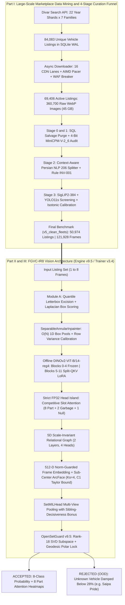
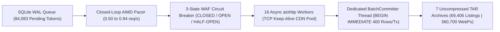
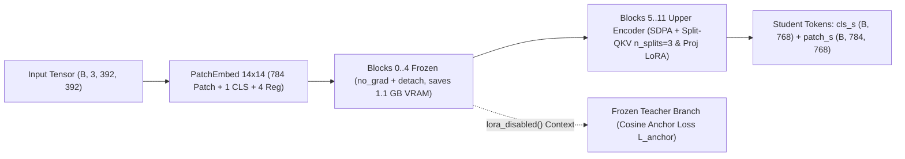
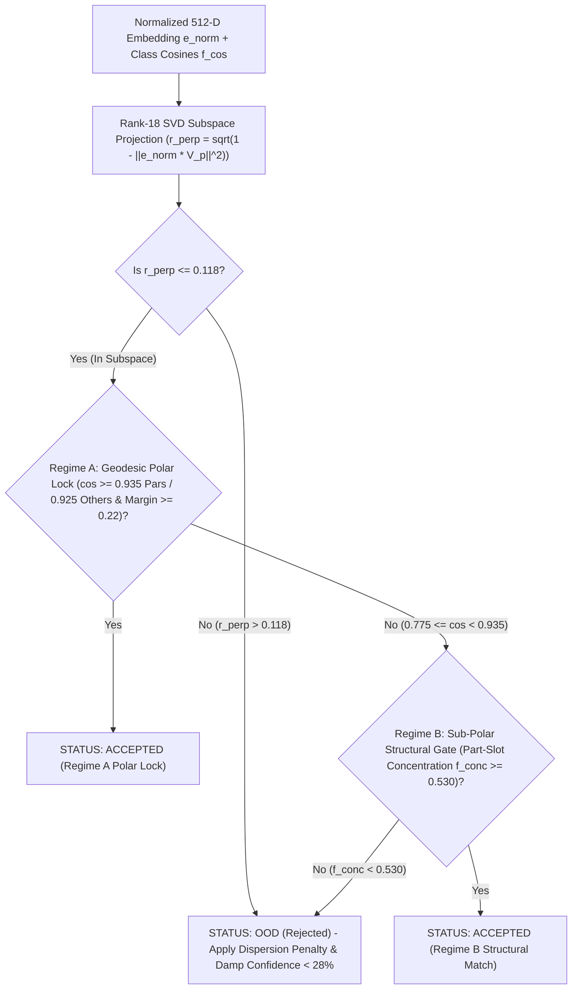
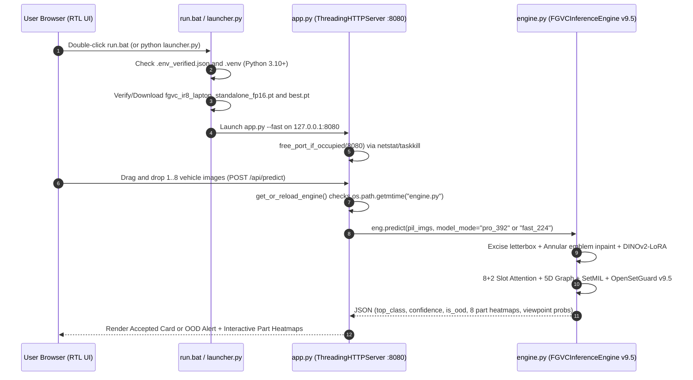

<div align="center">
  <h1 dir="rtl">FGVC-IR8: سامانه تشخیص ظریف خودروهای بازار ایران و غربالگری نمونه‌های ناشناس (Open-Set)</h1>
  <p dir="rtl"><b>پایپ‌لاین سرتاسری داده‌کاوی چندوجهی (۸۴,۰۸۳ آگهی دیوار) + معماری مبتنی بر اجزای DINOv2-ViT-B/14 برای دسته‌بندی چندتصویری خودروها و رد خودروهای خارج از توزیع روی پردازنده مرکزی (CPU)</b></p>
  <p>
    <a href="https://www.python.org/"></a>
    <a href="https://pytorch.org/"></a>
    <a href="https://www.kaggle.com/datasets/ahmadzmvd/fgvc-ir8-iranian-vehicle-dataset"></a>
    
    
    
  </p>
  <p dir="ltr">
    🌐 <b>Documentation Language / زبان مستندات:</b> &nbsp;
    <a href="README.md"><b>🇬🇧 English (Master Edition)</b></a> &nbsp;|&nbsp;
    <a href="README.fa.md"><b>🇮🇷 فارسی (نسخه فعلی)</b></a>
  </p>
</div>

<div dir="rtl" align="right">

> **📌 راهنمای مطالعه سریع بر اساس حوزه تخصصی شما**
> * **برای مدیران و متخصصان داده‌کاوی، مهندسی داده (`ETL`) و علم داده:** مستقیم به **بخش ۳ (پایپ‌لاین داده‌کاوی مقیاس‌بزرگ و قیف پالایش ۴مرحله‌ای)** بروید تا ببینید چطور ۸۴,۰۸۳ آگهی خودرو (~۳۶۰,۷۰۰ تصویر خام به حجم ۴۵ گیگابایت) با ۲۲ افراز زمانی از سقف ۵,۰۱۶ رکوردی API عبور کرد، با زمان‌بند غیرهمزمان `AIMD` و مدارقطع‌کن `WAF` دانلود شد، با مدل زبانی-بینایی ۴بیتی (`MiniCPM-V-2_6`) از خودروهای تصادفی و اوراقی پاکسازی شد، با پردازش زبان طبیعی فارسی به مدل‌های دقیق تفکیک شد و به ۱۲۱,۹۲۸ فریم استاندارد در ۵۰,۹۷۴ آگهی رسید.
> * **برای مدیران و مهندسان بینایی ماشین (`Computer Vision`) و یادگیری عمیق:** به **بخش ۵ (معماری بینایی مبتنی بر اجزا)** و **بخش ۶ (مهندسی پایداری عددی و کالبدشکافی استپ ۱۲,۳۵۶)** مراجعه کنید تا جزئیات تزریق `Split-QKV LoRA` روی `DINOv2-ViT-B/14-reg4`، مکانیسم `Competitive Slot Attention` (۸ اسلات قطعه + ۲ اسلات زباله)، گراف رابطه‌ای ۵بعدی ناوردا به مقیاس، تجمیع چندتصویری `Set-MIL`، خطی‌سازی مشتق‌پیوسته تیلور در `ArcFace` و سپر تشخیص خودروهای ناشناس `OpenSetGuard v9.5` را بررسی کنید.
> * **برای مهندسان نرم‌افزار و `MLOps`:** به **بخش ۷ (استنتاج آفلاین روی CPU و سرور وب با قابلیت Hot-Reload)** و **بخش ۹ (مجموعه ۲۳ تست خودکار و استرس‌تست)** سر بزنید تا نحوه اجرای مدل در `0.45` تا `1.15` ثانیه روی لپ‌تاپ ۸ گیگابایتی بدون کارت گرافیک را ببینید.

## فهرست مطالب

* **بخش ۱:** چرا این پروژه ساخته شد؟ (بیان مسئله و چالش‌های واقعی بازار ایران)
* **بخش ۲:** نمای کلی معماری سرتاسری سیستم
* **بخش ۳:** پایپ‌لاین داده‌کاوی مقیاس‌بزرگ و قیف پالایش ۴مرحله‌ای
  * ۳.۱ عبور از سقف ۵,۰۱۶ رکوردی ایندکس جستجو با ۲۲ افراز سال تولید
  * ۳.۲ دانلود غیرهمزمان با توان عملیاتی بالا (تنظیم‌کننده `AIMD` و مدارقطع‌کن `WAF`)
  * ۳.۳ مرحله ۰ و ۱: حذف `SQL` خودروهای اوراقی و ممیزی تصویری با مدل ۴بیتی `MiniCPM-V-2_6`
  * ۳.۴ مرحله ۲: تفکیک متنی هاچ‌بک و صندوقدار در زبان فارسی و قانون مهندسی `INV-001`
  * ۳.۵ مرحله ۳: غربالگری بصری دوگانه (`SigLIP2` + `YOLO11s`) و کالیبراسیون ایزوتونیک
  * ۳.۶ آمار دقیق افراز بدون نشت داده (`v5_clean_fleets`)
* **بخش ۴:** پیش‌پردازش پویا و جلوگیری از تقلب مدل از روی لوگو
  * ۴.۱ برش آماری حاشیه‌های اسکرین‌شات و امتیازدهی چندعاملی باکس‌ها
  * ۴.۲ بازسازی حلقوی تفکیک‌پذیر لوگو با پیچیدگی خطی و کالیبراسیون واریانس توکن‌ها
* **بخش ۵:** معماری بینایی مبتنی بر اجزا (`Engine v9.5` / `Trainer v3.4`)
  * ۵.۱ روایت قدم‌به‌قدم و شهودی معماری (ویژه مهندسان جونیور)
  * ۵.۲ تطبیق کم‌پارامتر ستون فقرات با `Split-QKV LoRA` و `SDPA`
  * ۵.۳ مکانیسم توجه رقابتی اسلات‌ها (`Competitive Slot Attention`)
  * ۵.۴ گراف رابطه‌ای ۵بعدی مستقل از مقیاس و جابجایی (`RelationalLayer`)
  * ۵.۵ هد `SubCenterArcFace` با گرادیان جداشده و بازنشانی `K-Means++` ساب‌سنترهای مرده
  * ۵.۶ تجمیع چندتصویری `Set-MIL` با مسیریابی قاطعیت خواهران ۲۰۶
  * ۵.۷ تشخیص سه‌وجهی ابهام نمای جلو و تابع هزینه `Partial Cross-Entropy`
  * ۵.۸ سپر دورژیمی تشخیص خودروهای ناشناس (`OpenSetGuard v9.5`)
* **بخش ۶:** مهندسی پایداری عددی و کالبدشکافی بحران استپ ۱۲,۳۵۶
* **بخش ۷:** استنتاج آفلاین روی `CPU` و سرور وب با قابلیت `Hot-Reload`
* **بخش ۸:** بنچمارک‌های آزمایشگاهی و روند آموزش
* **بخش ۹:** مجموعه ۲۳ یونیت‌تست و استرس‌تست خودکار
* **بخش ۱۰:** ساختار فایل‌های مخزن و راهنمای اجرای سریع

## ۱. چرا این پروژه ساخته شد؟ (بیان مسئله و چالش‌های واقعی بازار ایران)

مدل‌های استاندارد دسته‌بندی تصویر که روی دیتاست‌های تمیز دانشگاهی آموزش دیده‌اند، به محض مواجهه با عکس‌های واقعی پلتفرم‌های آگهی خودرو در ایران (مثل دیوار) از کار می‌افتند. سه واقعیت فنی در داده‌های بازار خودروی ایران باعث شکست مدل‌های متداول می‌شود:

* **چالش اول - پارادوکس شباهت کامل نمای جلو در خواهران خودرویی (`پژو ۲۰۶ هاچ‌بک` در برابر `پژو ۲۰۶ صندوقدار SD`):**
  در بازار ایران، **پژو ۲۰۶ هاچ‌بک (`c1`)** و **پژو ۲۰۶ صندوقدار (`c2`)** از نوک سپر جلو، چراغ‌ها، کاپوت، گلگیرها و شیشه جلو تا ستون وسط (`B-Pillar`) کاملاً یکسان هستند. از زاویه روبرو، حتی یک کارشناس رنگ و فنی خودرو هم نمی‌تواند بدون دیدن پشت ماشین بگوید خودرو هاچ‌بک است یا صندوقدار. اگر یک شبکه عصبی معمولی را مجبور کنیم روی تک‌عکس‌های نمای جلو یکی از دو برچسب `c1` یا `c2` را پیش‌بینی کند، مدل یا به بافت آسفالت و پس‌زمینه بیش‌برازش (`Overfit`) می‌شود یا گرادیان‌هایش مدام بین دو کلاس نوسان می‌کند. راه حل اصولی، دیدن هر آگهی به شکل یک **مجموعه چندتصویری (`Multi-View Set`)** است که در آن یک عکس از نمای عقب بتواند ابهام سه عکس نمای جلو را خنثی کند.
* **چالش دوم - فیس‌لیفت‌های بازاری و یادگیری میان‌بر از روی آرم خودرو (`Shortcut Learning`):**
  بسیاری از مالکان پژو ۲۰۶ در ایران چراغ‌ها، سپر و آینه‌های پژو ۲۰۷ را روی بدنه ۲۰۶ نصب می‌کنند، یا جلوپنجره پژو پارس و ۴۰۵ را تغییر می‌دهند. شبکه‌های کانولوشنی و ترنسفورمرهای معمولی خیلی سریع تنبلی می‌کنند و فقط با دیدن آرم شیر پژو یا نشان ایران‌خودرو در وسط جلوپنجره کلاس خودرو را حدس می‌زنند. به محض اینکه آرم خودرو کنده شود، اسپرت شود یا با لوگو پوشانده شود، دقت مدل سقوط می‌کند.
* **چالش سوم - نویز شدید عکس‌های کاربران و ورود خودروهای خارج از توزیع (`Open-Set Intruders`):**
  آگهی‌های خام پر از اسکرین‌شات‌های موبایل با نوارهای سیاه بالا و پایین، عکس از موتور، داشبورد، روکش صندلی، خودروهای تصادفی یا چپی و خودروهایی خارج از ۸ کلاس هدف (مثل **پراید ۱۳۱ و ۱۱۱، تیبا، ساینا، سمند** یا خودروهای وارداتی) هستند. یک دسته‌بند `Softmax` معمولی وقتی عکس پراید را می‌بیند، با اطمینان ۹۹٪ آن را به یکی از ۸ کلاس موجود نسبت می‌دهد.

پروژه **FGVC-IR8** برای حل مهندسی این سه چالش از صفر طراحی و پیاده‌سازی شده است: ترکیب یک **قیف داده‌کاوی و پالایش ۴مرحله‌ای روی ۸۴,۰۸۳ آگهی دیوار** با یک **موتور بینایی ماشین مبتنی بر اجزا و گراف هندسی (`v9.5`)** که بدون نیاز به کارت گرافیک (`GPU`)، روی یک لپ‌تاپ معمولی با ۸ گیگابایت رم اجرا می‌شود.

## ۲. نمای کلی معماری سرتاسری سیستم

دیاگرام زیر جریان کامل داده و پردازش را از لحظه استخراج آگهی‌های خام دیوار در **پایپ‌لاین داده‌کاوی (بخش اول)** تا استنتاج چندتصویری و رد خودروهای ناشناس در **موتور بینایی ماشین (بخش‌های دوم تا چهارم)** نشان می‌دهد:

</div>



<div dir="rtl" align="right">

## ۳. بخش اول: پایپ‌لاین داده‌کاوی مقیاس‌بزرگ و قیف پالایش ۴مرحله‌ای

> **💡 چرا این بخش برای تیم‌های داده‌کاوی، مهندسی داده و علم داده اهمیت دارد؟**
> در پروژه‌های صنعتی هوش مصنوعی، رسیدن به دقت ۹۷.۹۹٪ محصول تمیزکاری، مهندسی ویژگی و پالایش چندمرحله‌ای داده است، نه صرفاً تغییر ابرپارامترهای شبکه عصبی. بیش از ۶۵٪ بار مهندسی این پروژه صرف ساختن پایپ‌لاین مقاوم در برابر خطا برای استخراج، همگام‌سازی و پالایش ۳۶۰,۷۰۰ تصویر واقعی از بازار خودروی ایران شده است.

### ۳.۱ عبور از سقف ۵,۰۱۶ رکوردی ایندکس جستجو با ۲۲ افراز سال تولید

**تنگنای مهندسی (نگاه شهودی):**
در اندپوینت داخلی جستجوی دیوار (`POST /v8/postlist/w/search`)، صفحه‌بندی با ارسال نشانه زمانی میکروثانیه‌ای (`last_post_date`) و آرایه فشرده‌شده توکن‌های دیده‌شده (`viewed_tokens` در قالب `Gzip + Base64`) انجام می‌شود. اما موتور جستجوی بک‌اند یک محدودیت سخت (`max_result_window`) روی **صفحه ۲۰۹ (معادل ۵,۰۱۶ آگهی)** دارد. هر کوئری کلی برای خودروهای پرتیراژی مثل پژو پارس یا ۲۰۶ بعد از ۵,۰۱۶ آگهی متوقف می‌شود و بیش از ۷۵٪ آگهی‌های بازار را از دست می‌دهد.

**راهکار مهندسی پیاده‌سازی‌شده (نگاه عمیق):**
* **کشف مسیر `RBAC` اندپوینت جزئیات آگهی:** ارسال درخواست به مسیر `/v8/posts-v2/web/post/{token}` با خطای `HTTP 403 Forbidden` فایروال مواجه می‌شد. بررسی ترافیک شبکه نشان داد که حذف بخش `/post/` و فراخوانی مستقیم `/v8/posts-v2/web/{token}` محدودیت دسترسی را به طور کامل برطرف می‌کند. همچنین خطای `HTTP 400 Bad Request` در استخراج خانواده پژو ۲۰۷ با اصلاح اسکیمای برند داخلی به `Peugeot 207i` برطرف شد.
* **افراز ۲۲گانه بر اساس سال تولید (`number_range`):** برای اینکه حجم پاسخ هیچ کوئری جستجویی به سقف ۵,۰۱۶ آگهی نرسد، فضای جستجوی ۷ خانواده خودرو بر اساس فیلتر سال تولید شمسی (۱۳۸۰ تا ۱۴۰۴) در اسکیمای `Protobuf` به **۲۲ شارد زمانی مجزا** شکسته شد.
* **مدیریت اتصال پایدار `SQLite WAL` در ویندوز:** در نسخه‌های اولیه، باز و بسته کردن مکرر کانکشن‌های دیتابیس باعث خطای قفل فایل ویندوز (`WinError 32`) و خطای `no such table: posts` می‌شد. با بازطراحی لایه ذخیره‌سازی حول یک کانکشن واحد پایدار در مد `Write-Ahead Logging (WAL)` و افزودن محافظ سیستمی ویندوز (`WindowsSystemGuard` با فراخوانی `SetThreadExecutionState` برای جلوگیری از `Sleep` شدن سیستم و غیرفعال‌سازی `QuickEdit` کنسول)، متادیتای **۸۴,۰۸۳ آگهی یکتا** بدون قطعی استخراج شد.

### ۳.۲ دانلود غیرهمزمان با توان عملیاتی بالا (تنظیم‌کننده AIMD و مدارقطع‌کن WAF)

دانلود تصاویر و متادیتای تکمیلی برای ۸۴,۰۸۳ آگهی با معماری ترتیبی اولیه (`V1`) به طور میانگین **۴.۴ ثانیه به ازای هر آگهی** زمان می‌برد (معادل **۱۰۲ ساعت** اجرای پیوسته). بازطراحی کامل موتور دانلود در قالب معماری غیرهمزمان تولیدکننده-مصرف‌کننده (`v2_pipeline.py`, `v2_pacer.py`, `v2_storage.py`) سرعت پایپ‌لاین را **۵.۵ برابر** افزایش داد:

</div>



<div dir="rtl" align="right">

* **تنظیم‌کننده نرخ حلقه بسته `AIMD` (`v2_pacer.py`):** به جای استفاده از تاخیرهای ثابت که یا پهنای باند را هدر می‌دهند و یا باعث مسدود شدن `IP` می‌شوند، الگوریتم **افزایش جمعی / کاهش ضربی (`AIMD`)** با نویز تصادفی ۱۵ درصدی پیاده‌سازی شد. نرخ ارسال از `0.50 req/s` شروع شده و به ازای هر ۵۰ پاسخ موفق پیاپی، `0.05 req/s` افزایش می‌یابد تا به نقطه تعادل `0.94 req/s` برسد و در صورت مشاهده اولین خطای `HTTP 429` فوراً نصف می‌شود.
* **مدارقطع‌کن ۳حالته فایروال (`Circuit Breaker`):** محتوای پاسخ‌ها را رصد می‌کند و اگر به جای ساختار `JSON`، صفحه چالش `HTML` فایروال برگردد، مدار به حالت `OPEN` می‌رود، تمام ورکرها را برای بازه زمانی نمایی متوقف می‌کند و سپس در حالت `HALF-OPEN` سلامت مسیر را تست می‌کند.
* **نخ اختصاصی ثبت دسته‌ای (`BatchCommitter`):** عملیات دیسک را از کروتین‌های شبکه جدا کرده و رکوردهای دانلودشده را در دسته‌های **۴۰۰تایی** با تراکنش صریح `BEGIN IMMEDIATE` در `SQLite` ثبت می‌کند.
* **خروجی نهایی دانلود:** **۶۹,۴۰۶ آگهی فعال** (سایر آگهی‌ها در فاصله زمانی بین کشف توکن و دانلود عکس توسط فروشندگان حذف شده بودند) شامل **~۳۶۰,۷۰۰ تصویر `WebP` (به حجم ۴۵ گیگابایت)** مستقیماً داخل ۷ آرشیو `.tar` ذخیره شد تا سیستم فایل دچار فرسایش میلیون‌ها فایل کوچک نشود.

### ۳.۳ مرحله ۰ و ۱: حذف SQL خودروهای اوراقی و ممیزی تصویری با مدل ۴بیتی `MiniCPM-V-2_6`

در آگهی‌های واقعی، خودروهای تصادفی، چپی، سوخته یا اوراقی که صرفاً برای فروش لاشه یا مدارک آگهی شده‌اند، ساختار بصری قطعات را تخریب می‌کنند.

* **مرحله ۰ (پاکسازی قطعی با قواعد `SQL` و عبارت‌های باقاعده):**
  با اجرای فیلتر روی متادیتای وضعیت بدنه (`body_status IN ('تصادفی', 'اوراقی')`) و الگوهای متنی خریداران ضایعات و حواله (`"خریدار تصادفی"`, `"حواله"`, `"پیش فروش"`)، تعداد **۷۴۰ آگهی اوراقی قطعی** درجا حذف شدند. همچنین تعداد **۲,۵۲۴ آگهی مشکوک (ناحیه خاکستری)** که در آن‌ها وضعیت شاسی `"ضربه‌خورده"` ثبت شده بود اما وضعیت بدنه سالم ادعا شده بود، در فایل `suspects_for_vlm.json` ایزوله شدند.
* **مرحله ۱ (ممیزی بصری خودروهای مشکوک با مدل زبانی-بینایی ۴بیتی):**
  مدل `openbmb/MiniCPM-V-2_6` با کوانتیزاسیون `4-bit NF4` (مصرف حافظه تنها `5.39 GB VRAM` روی کارت گرافیک `Tesla T4`) روی تمام **۱۳,۳۳۸ تصویر** متعلق به **۲,۵۲۱ آگهی مشکوک معتبر** اجرا شد (۳ توکن معیوب و اشتباهی پراید یعنی `gaT6mR0p`, `gaTGL93S` و `gaTKbU4g` حین استخراج جریانی از فایل‌های `TAR` شناسایی و حذف شدند).
  * رفع باگ ناسازگاری `AttributeError: 'MiniCPMV' object has no attribute 'all_tied_weights_keys'` در نسخه‌های جدید کتابخانه `transformers` با تزریق پویا (`Monkey-Patching`).
  * کاهش زمان استنتاج هر خودرو از **۳۳ ثانیه به ~۶.۵ ثانیه** با تنظیم `max_slice_nums=1` و حذف برش‌های ۹گانه غیرضروری روی تصاویر بندانگشتی.
  * حذف «تله اطمینان ۵۰ درصدی» مدل زبانی با پیش‌پر کردن بافر پاسخ با کاراکتر `{` جهت تولید قطعی خروجی `JSON`.
  * ساخت داشبورد تعاملی `HTML` (`forensic_vlm_master_audit.html`) و قرنطینه کامل خودروهای تصادفی تاییدشده (`quarantine_manifest.json`).

### ۳.۴ مرحله ۲: تفکیک متنی هاچ‌بک و صندوقدار در زبان فارسی و قانون مهندسی `INV-001`

در درخت دسته‌بندی دیوار، هر دو مدل **پژو ۲۰۶ هاچ‌بک** و **پژو ۲۰۶ صندوقدار (`SD`)** زیر یک عنوان واحد (`peugeot-206`) و هر دو مدل **پژو ۲۰۷ هاچ‌بک** و **پژو ۲۰۷ صندوقدار** زیر عنوان `peugeot-207` ثبت می‌شوند. جستجوی ساده کلیدواژه‌های `"صندوق"` یا `"اس دی"` روی متن آگهی‌های فارسی به شدت خطا می‌دهد، چون فروشندگان خودروهای هاچ‌بک در متن آگهی می‌نویسند:
* عبارت *«درب صندوق عقب و کف صندوق بی‌رنگ و پلمپ»* (اشاره به قطعه درب پشت هاچ‌بک)
* عبارت *«معاوضه با ۲۰۶ صندوقدار یا پارس»* (اشاره به خودروی مورد نظر برای معاوضه، نه خودروی آگهی‌شده)
* عبارت *«اتوگالری و نمایشگاه اسدی»* (نام خانوادگی «اسدی» که شامل زیررشته «اس دی» است).

کلاس `CarVariantClassifier` با یک پایپ‌لاین ۳مرحله‌ای پردازش متن فارسی این تله‌های معنایی را خنثی می‌کند:
* **گام اول - نرمال‌سازی یونیکد و نیم‌فاصله‌ها:** یکسان‌سازی حروف عربی (`ي/ك` به `ی/ک`) و حذف کاراکترهای کشیده و نیم‌فاصله‌های مزاحم.
* **گام دوم - ماسک‌گذاری تله‌های معنایی قبل از استنتاج:** تبدیل عبارات قطعات بدنه (`"درب/کف/قفل/نمد صندوق"` به `[TRUNK_PART]`)، جملات معاوضه (`"معاوضه با ..."` به `[TRADE_CLAUSE]`) و اسامی خاص (`"نمایشگاه اسدی"` به `[PERSON_ASADI]`).
* **گام سوم - استخراج سیگنال‌های قطعی تیپ صندوقدار:** تطابق تیپ‌های اختصاصی سدان (`v8, v9, v20, v1, v2, v10, صندوقدار, sd, اس دی`).

**خروجی تفکیک مرحله ۲ و کشف قانون مهندسی `INV-001`:**
* **خانواده پژو ۲۰۶:** تفکیک دقیق به **۱۶,۸۱۵ آگهی هاچ‌بک (۷۸,۷۶۷ تصویر)** و **۳,۰۵۲ آگهی صندوقدار `SD` (۱۴,۹۲۲ تصویر)**.
* **خانواده پژو ۲۰۷ و حذف دائمی ۲۰۷ صندوقدار (`Rule INV-001`):** از مجموع ۱۳,۲۱۵ آگهی پژو ۲۰۷، تعداد **۱۳,۱۳۳ آگهی (۳۸,۷۶۱ تصویر)** هاچ‌بک بودند و فقط **۸۲ آگهی (۳۵۳ تصویر در کل دیتاست)** پژو ۲۰۷ صندوقدار واقعی بودند (یعنی تنها `0.62%` از خانواده ۲۰۷ و **عدم توازن ۱۶۰ به ۱**). نگه داشتن کلاسی با تنها ۸۲ آگهی باعث ناپایداری شدید گرادیان و واریانس کاذب در ارزیابی چندتصویری می‌شد. طبق **قانون مهندسی `INV-001`**، این ۸۲ آگهی (۳۵۳ تصویر) به طور دائمی در لیست سیاه قرار گرفتند و حذف شدند تا دیتاست نهایی روی **۸ کلاس استاندارد و پرتعداد (`FGVC-IR8`)** قفل شود.
* همچنین **۱,۱۰۱ تصویر یتیم (`Orphaned`)** متعلق به ۲۶۵ توکن فاقد متادیتا شناسایی و پاکسازی شدند.

### ۳.۵ مرحله ۳: غربالگری بصری دوگانه (`SigLIP2` + `YOLO11s`) و کالیبراسیون ایزوتونیک

حتی در آگهی‌های خودروی سالم، حدود ۶۰٪ عکس‌های آپلودشده توسط کاربران نمای بیرونی بدنه نیستند (عکس از کفپوش، کیلومترشمار، ضبط، لاستیک، سوییچ یا عکس‌های تار شبانه). اسکریپت مرحله ۳ (`divar_phase2_screen.py` در ۱,۴۰۸ خط) تمام **۳۲۷,۸۸۰ تصویر کاندید** را با سرعت **~۲۵ تصویر بر ثانیه** با استفاده از حافظه مشترک چندپردازشی (`SharedMemory`) اسکن کرد:

* **استخراج ویژگی دومسیره (`Semantic + Geometric`):**
  * **مسیر معنایی (`SigLIP2`):** مدل `google/siglip2-base-patch16-384` بردارهای امبدینگ ۷۶۸بعدی نرمال‌شده (`FP16` ذخیره‌شده در `emb_*.f16`) و امتیاز شباهت کسینوسی با پرامپت‌های متنی نمای بیرونی در برابر نمای داخلی و قطعات را استخراج کرد.
  * **مسیر هندسی (`YOLO11s`):** مدل `yolo11s.pt` در رزولوشن `640x640` باکس‌های خودرو (کلاس‌های `{0, 2, 5, 7}`)، نسبت مساحت خودروی اصلی، نسبت ابعاد، بریدگی در لبه‌های تصویر و تراکم خودروهای پس‌زمینه را استخراج کرد.
* **مدل مخلوط گوسی (`GMM`) + پروب لجستیک ۵لایه + کالیبراسیون ایزوتونیک:**
  ترکیب مدل `GMM` بدون نظارت با یک **پروب رگرسیون لجستیک چندجمله‌ای ۵لایه (`5-Fold Out-of-Fold`)** روی امبدینگ‌های ۷۶۸بعدی و ویژگی‌های هندسی `YOLO`، همراه با **کالیبراسیون ایزوتونیک (`Isotonic Calibration`)** که به **دقت (`Precision`) ۹۷.۱۹٪** در جداسازی فریم‌های نمای بیرونی خودرو رسید (`phase3_seed_coco.json` شامل ۱۵۹,۳۰۶ باکس نرمال‌شده).
* **دروازه فاصله دوربین و حذف آگهی‌های تکراری با گراف `Union-Find`:**
  اعمال شرط حداقل مساحت باکس $g_{\min} = 0.1597$ (معادل فاصله فیزیکی دوربین تا خودرو کمتر از ۶ متر) جهت حذف عکس‌های گرفته شده از فاصله دور در خیابان، و ساخت گراف مؤلفه‌های همبند (**`Union-Find`**) روی شباهت کسینوسی امبدینگ‌ها برای ادغام آگهی‌های تکراری نمایشگاه‌داران در یک گروه واحد.

### ۳.۶ آمار دقیق افراز بدون نشت داده (`v5_clean_fleets`)

برای تضمین **صفر بودن نشت داده (`Zero Data Leakage`)** بین داده‌های آموزش و ارزیابی، افراز دیتاست (`splits.json` و `split_telemetry.json`) با الگوریتم `GroupKFold` دقیقاً در **سطح شناسه آگهی خودرو** انجام شده است (هیچ دو عکسی از یک خودروی واحد بین `Train` و `Val/Test` مشترک نیست) و تابع `assert_pairwise_disjoint(splits)` در `trainer.py` قبل از شروع آموزش این شرط را بررسی می‌کند:

| کد کلاس | نام انگلیسی کلاس | نام فارسی کلاس | تصاویر Train | تصاویر Val | تصاویر Test | مجموع تصاویر | سهم از کل دیتاست |
| :---: | :---: | :---: | :---: | :---: | :---: | :---: | :---: |
| **`c0`** | **Peugeot Pars** | پژو پارس | ۲۱,۱۸۸ | ۲,۷۵۵ | ۲,۷۲۸ | **۲۶,۶۷۱** | ۲۱.۸۷٪ |
| **`c1`** | **Peugeot 206 HB** | پژو ۲۰۶ هاچ‌بک | ۲۲,۰۶۴ | ۲,۷۱۳ | ۲,۷۴۶ | **۲۷,۵۲۳** | ۲۲.۵۷٪ |
| **`c2`** | **Peugeot 206 SD** | پژو ۲۰۶ صندوق‌دار | ۴,۲۴۸ | ۵۸۲ | ۴۴۵ | **۵,۲۷۵** | ۴.۳۳٪ |
| **`c3`** | **Peugeot 207 HB** | پژو ۲۰۷ هاچ‌بک | ۱۲,۲۴۸ | ۱,۴۴۴ | ۱,۴۱۹ | **۱۵,۱۱۱** | ۱۲.۳۹٪ |
| **`c4`** | **IKCO Dena** | دنا | ۱۴,۲۴۹ | ۱,۷۱۱ | ۱,۹۱۳ | **۱۷,۸۷۳** | ۱۴.۶۶٪ |
| **`c5`** | **IKCO Tara** | تارا | ۴,۵۲۸ | ۵۹۰ | ۵۲۵ | **۵,۶۴۳** | ۴.۶۳٪ |
| **`c6`** | **Saipa Quick** | کوییک | ۱۴,۰۲۲ | ۱,۷۲۴ | ۱,۸۱۰ | **۱۷,۵۵۶** | ۱۴.۴۰٪ |
| **`c7`** | **Saipa Shahin** | شاهین | ۴,۹۸۲ | ۶۶۳ | ۶۳۱ | **۶,۲۷۶** | ۵.۱۵٪ |
| **مجموع** | **8 Target Classes** | **۸ کلاس خودرویی** | **۹۷,۵۲۹** *(۴۰,۷۷۹ آگهی)* | **۱۲,۱۸۲** *(۵,۰۹۸ آگهی)* | **۱۲,۲۱۷** *(۵,۰۹۷ آگهی)* | **۱۲۱,۹۲۸** *(۵۰,۹۷۴ آگهی)* | **۱۰۰.۰۰٪** |

از آنجا که تعداد فریم‌های آموزش `پژو ۲۰۶ هاچ‌بک` (`22,064`) حدود ۵.۲ برابر `پژو ۲۰۶ صندوقدار` (`4,248`) است، کلاس `StreamBatchSampler` احتمال انتخاب هر کلاس را با رابطه توانی زیر تنظیم می‌کند تا هم کلاس‌های پرتعداد غالب نشوند و هم کلاس‌های کم‌تعداد دچار بیش‌برازش نشوند:

</div>

<div dir="ltr" align="left">

$$
\pi_c = \frac{N_c^{\alpha}}{\sum_{j=0}^{7} N_j^{\alpha}}, \quad \alpha = 0.5
$$

</div>

<div dir="rtl" align="right">

## ۴. بخش دوم: پیش‌پردازش پویا و جلوگیری از تقلب مدل از روی لوگو

### ۴.۱ برش آماری حاشیه‌های اسکرین‌شات و امتیازدهی چندعاملی باکس‌ها

**نگاه شهودی (ویژه مهندسان جونیور):**
بخش زیادی از عکس‌های دیوار اسکرین‌شات‌های موبایل با نوارهای سیاه یا سفید در بالا و پایین تصویر هستند، یا در یک عکس خیابانی چند ماشین پارک‌شده در کنار خودروی اصلی دیده می‌شوند. ماژول `DynamicPreprocessEngine` (`module_a_preprocess.py`) ابتدا نوارهای مصنوعی اسکرین‌شات را می‌بُرد و سپس با ترکیب مساحت، مرکزیت و وضوح لبه‌ها (`Laplacian Sharpness`)، دقیقاً خودروی اصلی فروشنده را کادرگیری می‌کند.

**فرمولاسیون ریاضی (ویژه مهندسان ارشد):**
* **برش کوانتایلی حاشیه‌های تصویر (`excise_letterbox`):**
  تصویر ورودی به کانال روشنایی با حداکثر ضلع ۳۸۴ پیکسل تبدیل می‌شود و خطوط تصویر از هر چهار جهت اسکن می‌شوند. یک خط اسکن $l$ به عنوان حاشیه مصنوعی علامت می‌خورد اگر شرط زیر برقرار باشد:

</div>

<div dir="ltr" align="left">

$$
\left(Q_{0.999}(l) \le \frac{24}{255} \;\wedge\; \sigma(l) \le 0.025\right) \;\lor\; \left(Q_{0.001}(l) \ge \frac{232}{255} \;\wedge\; \sigma(l) \le 0.025\right)
$$

</div>

<div dir="rtl" align="right">

  در صورتی که پله جهش روشنایی در مرز حاشیه $|\mu(l_t) - \mu(l_{t-1})| \ge 0.04$ باشد و کل ناحیه بریده‌شده کمتر از ۴۵٪ ابعاد عکس باشد، مستطیل مفید $\Omega = (x_0, y_0, x_1, y_1)$ استخراج می‌شود.

* **امتیازدهی چندعاملی باکس‌های خودرو (`score_boxes`):**
  برای هر باکس کاندید $b_k$ داخل $\Omega$، امتیاز لگاریتمی بر اساس مساحت نسبی $A_k$، مجذور فاصله از مرکز کادر $d_k^2$، نرخ بریدگی در لبه‌ها $\tau_k$ و واریانس فیلتر لاپلاسین $L_k$ محاسبه می‌شود:

</div>

<div dir="ltr" align="left">

$$
\log S(b_k) = 0.6 \ln(A_k) - \frac{d_k^2}{2(0.30)^2} + \ln(1 - 0.5\tau_k) + 0.15 \ln(L_k)
$$

</div>

<div dir="rtl" align="right">

  باکس با بیشترین امتیاز انتخاب شده و نسبت رقابت خودروی دوم $\rho = \exp(\log S(b_{(2)}) - \log S(b_{(1)})) \in [0, 1]$ محاسبه می‌شود تا در تصاویر شلوغ، وزن تابع هزینه مکان‌یابی با ضریب $(1 - 0.5\rho)$ تعدیل شود.

### ۴.۲ بازسازی حلقوی تفکیک‌پذیر لوگو با پیچیدگی خطی و کالیبراسیون واریانس توکن‌ها

**چرا لوگوی وسط جلوپنجره را حذف می‌کنیم؟**
اگر مدل در زمان آموزش مدام لوگوی شیر پژو یا آرم ایران‌خودرو و سایپا را ببیند، به جای یادگیری هندسه چراغ و خطوط کاپوت، صرفاً شکل لوگو را حفظ می‌کند.

**نحوه عملکرد `SeparableAnnularInpainter` در `engine.py`:**
* **فیلتر میانگین دوبعدی تفکیک‌پذیر (`separable_box_pool2d`):**
  اجرای فیلتر میانگین دوبعدی با پنجره `81x81` در حالت عادی پیچیدگی مربعی دارد. در `engine.py` این عملیات به دو فیلتر یک‌بعدی متوالی افقی و عمودی (`kernel=(1, k)` و سپس `kernel=(k, 1)`) شکسته شده که روی `CPU` تنها **`2.2 میلی‌ثانیه`** زمان می‌برد و حداکثر اختلاف عددی آن با فیلتر دوبعدی کامل **`8.94e-8`** (معادل ۱ واحد `ULP` در ممیز شناور ۳۲ بیتی) است.
* **تشخیص و بازسازی حلقوی ناحیه لوگو:**
  پیکسل‌های با واریانس محلی پایین ($\sigma_{\mathrm{local}}^2 < 2.5$) و اشباع رنگی بالا ($S > 75.0$) در ناحیه مرکزی شناسایی شده و با گسترش حلقوی `3x3` از پیکسل‌های تمیز اطراف بازسازی (`Inpaint`) می‌شوند.
* **کالیبراسیون واریانس توکن‌های بازسازی‌شده (`_calibrate_inpainted_origin_tokens`):**
  از آنجا که نواحی بازسازی‌شده بافت نرم‌تری دارند، توکن‌های خروجی پچ در `ViT` واریانس کمتری پیدا می‌کنند و خودِ این افت واریانس می‌تواند به یک سیگنال مصنوعی برای شبکه تبدیل شود. در `OfflineDinoViTB14Reg`، توکن‌های واقع در ناحیه ماسک طی ۳ گام آرام‌سازی افقی، واریانس کانال‌های خود را با پچ‌های همسایه در همان ردیف جلوپنجره و سپر هم‌تراز می‌کنند.

## ۵. بخش سوم: معماری بینایی مبتنی بر اجزا (Engine v9.5 / Trainer v3.4)

### ۵.۱ روایت قدم‌به‌قدم و شهودی معماری (ویژه مهندسان جونیور)

قبل از ورود به معادلات، بیایید ببینیم وقتی ۱ تا ۸ عکس از یک آگهی خودرو وارد موتور `FGVC-IR8` می‌شود، چه اتفاقی می‌افتد:

* **گام اول - تبدیل عکس به پچ‌های معنایی (`DINOv2` + `LoRA`):** هر تصویر به مربع‌های `14x14` پیکسلی تقسیم می‌شود (در رزولوشن `392x392`، یک شبکه `28x28` یعنی **۷۸۴ پچ** داریم). مدل پایه `DINOv2-ViT-B/14-reg4` هر پچ را به یک بردار ۷۶۸بعدی تبدیل می‌کند. ۵ بلاک اول شبکه فریز شده‌اند (چون لبه‌ها و بافت‌های پایه را استخراج می‌کنند) و روی ۷ بلاک بالایی، آداپتورهای سبک **`LoRA`** نصب شده تا مدل بدون فراموش کردن دانش قبلی، ظرافت‌های بدنه خودروهای ایرانی را یاد بگیرد.
* **گام دوم - رقابت اسلات‌ها برای شکار ۸ قطعه خودرو (`Competitive Slot Attention`):** به جای اینکه هر ۷۸۴ پچ را با هم جمع بزنیم، ۱۰ «اسلات» طی ۳ دور با هم رقابت می‌کنند تا پچ‌های تصویر را تصاحب کنند. **۸ اسلات قطعه** روی اجزای اصلی خودرو (چراغ جلو، جلوپنجره، سپر جلو، کاپوت و شیشه، آینه بغل، رینگ و لاستیک، چراغ خطر عقب، درب صندوق و سپر عقب) قفل می‌شوند و **۲ اسلات زباله** به همراه یک **اسلات خنثی (`Null`)** آسفالت خیابان، درختان و آسمان پس‌زمینه را می‌بلعند.
* **گام سوم - ساخت گراف هندسی ۵بعدی بین قطعات (`5D Relational Graph`):** مدل مرکز ثقل و شعاع هر یک از ۸ قطعه را روی تصویر حساب می‌کند و یک گراف کامل `8x8` می‌سازد که در آن هر یال نشان می‌دهد قطعه $i$ نسبت به قطعه $j$ در چه زاویه، فاصله و مقیاسی قرار گرفته است.
* **گام چهارم - ترکیب هوشمند چند عکس از یک ماشین (`Set-MIL Head`):** اگر آگهی دارای ۳ عکس از روبروی پژو ۲۰۶ و ۱ عکس از پشت ماشین باشد، ماژول `SetMILHead` تشخیص می‌دهد که عکس عقب اختلاف امتیاز بالایی بین ۲۰۶ هاچ‌بک و ۲۰۶ صندوقدار ایجاد کرده است؛ بنابراین به تک‌عکس نمای عقب **۲۹.۴ برابر وزن بیشتر** از عکس‌های مبهم جلو می‌دهد!
* **گام پنجم - رد خودروهای غریبه (`OpenSetGuard v9.5`):** در گام آخر، بردار ۵۱۲بعدی خودرو روی یک زیرفضای ۱۸بعدی (حاصل از تجزیه `SVD` هشت کلاس مجاز) تصویر می‌شود. اگر کاربر عکس **پراید** آپلود کند، بردار آن عمود بر این زیرفضا بیرون می‌زند ($r_\perp > 0.118$) و سیستم به جای حدس زدن اشتباه، اعلام می‌کند خودرو خارج از توزیع (`OOD`) است.

### ۵.۲ تطبیق کم‌پارامتر ستون فقرات با `Split-QKV LoRA` و `SDPA`

</div>



<div dir="rtl" align="right">

* **ستون فقرات (`Backbone`):** شبکه `dinov2_vitb14_reg` با بُعد امبدینگ $D = 768$، شامل ۱۲ بلاک ترنسفورمر، ۱۲ هد توجه، ۱ توکن `[CLS]` و ۴ توکن ثبات (`Register Tokens`).
* **فریز کردن ۵ بلاک ابتدایی (`Blocks 0..4`):** اجرای بلاک‌های ۰ تا ۴ داخل `with torch.no_grad():` و فراخوانی `h0 = h.detach()`، ضمن حفظ فیلترهای پایه گابور و رنگ، **۱.۱ گیگابایت از مصرف حافظه `VRAM`** گراف اتوگرد را روی کارت `Tesla T4` آزاد می‌کند.
* **پچینگ کرنل `SDPA` (`patch_sdpa`):** جایگزینی محاسبات توجه استاندارد با `F.scaled_dot_product_attention` که پیچیدگی حافظه ماتریس توجه را از درجه دو به خطی کاهش می‌دهد.
* **معماری `LoRALinear` با تفکیک سه‌گانه ماتریس `qkv` (`n_splits=3`):**
  در لایه‌های توجه `ViT`، ماتریس `qkv` دارای ابعاد $(2304, 768)$ است که سه فضای `Query`، `Key` و `Value` را در یک ماتریس واحد ادغام کرده است. اعمال یک `LoRA` یکپارچه روی کل ماتریس `qkv` باعث اختلاط زیرفضای رتبه پایین بین $Q, K, V$ می‌شود. کلاس `LoRALinear` با تنظیم `n_splits=3` روی `qkv` و `n_splits=1` روی `proj` در بلاک‌های ۵ تا ۱۱، سه آداپتور کاملاً مستقل به $Q, K, V$ اختصاص می‌دهد:

</div>

<div dir="ltr" align="left">

$$
\mathbf{y} = \mathbf{W}_0 \mathbf{x} + \frac{\alpha}{r} \bigoplus_{s=1}^{S_{\mathrm{split}}} \mathbf{B}_s \left(\mathbf{A}_s \mathbf{x}\right)
$$

</div>

<div dir="rtl" align="right">

  * **محاسبه دقیق ۶۸۸,۱۲۸ پارامتر آموزش‌پذیر `LoRA`:**
    * در هر بلاک برای `qkv` (`n_splits=3`, $r=16, \alpha=16.0$): تنسور $\mathbf{A}_{\mathrm{qkv}} \in \mathbb{R}^{3 \times 16 \times 768}$ (`36,864`) + تنسور $\mathbf{B}_{\mathrm{qkv}} \in \mathbb{R}^{3 \times 768 \times 16}$ (`36,864`) = **`73,728` پارامتر**.
    * در هر بلاک برای `proj` (`n_splits=1`, $r=16, \alpha=16.0$): تنسور $\mathbf{A}_{\mathrm{proj}} \in \mathbb{R}^{1 \times 16 \times 768}$ (`12,288`) + تنسور $\mathbf{B}_{\mathrm{proj}} \in \mathbb{R}^{1 \times 768 \times 16}$ (`12,288`) = **`24,576` پارامتر**.
    * مجموع در ۷ بلاک آموزش‌پذیر (`5..11`): $7 \times (73,728 + 24,576) =$ **۶۸۸,۱۲۸ پارامتر در قالب ۲۸ تنسور `LoRA`**.
* **لنگر خودتقطیری معلم-دانش‌آموز ($\mathcal{L}_{\mathrm{anchor}}$):** در حین آموزش، خروجی `h0` یک بار هم با غیرفعال کردن موقت لایه‌های `LoRA` (`with lora_disabled(self.lora_layers):`) از بلاک‌های ۵ تا ۱۱ عبور داده می‌شود تا فاصله کسینوسی توکن‌های دانش‌آموز از توکن‌های معلمِ فریزشدۀ `DINOv2` مهار شود:

</div>

<div dir="ltr" align="left">

$$
\mathcal{L}_{\mathrm{anchor}} = \left(1 - \cos(\mathbf{c}_s, \mathbf{c}_t)\right) + \left(1 - \cos(\mathbf{P}_s, \mathbf{P}_t)\right)
$$

</div>

<div dir="rtl" align="right">

### ۵.۳ مکانیسم توجه رقابتی اسلات‌ها (`Competitive Slot Attention`)

توکن‌های مکانی پچ‌ها $\mathbf{P}_s \in \mathbb{R}^{N \times N_p \times 768}$ به فضای ۲۵۶بعدی تصویر شده و با خروجی شبکه مختصات مکانی جمع می‌شوند. سپس در `CompetitiveSlotAttention`، تعداد ۱۰ اسلات (**۲ اسلات زباله و پس‌زمینه** با اندیس‌های `0, 1` و **۸ اسلات قطعات خودرو** با اندیس‌های `2..9`) به همراه یک **لوجیت خنثی (`null_logit`)** طی ۳ تکرار بازگشتی رقابت می‌کنند:

</div>

<div dir="ltr" align="left">

$$
\mathbf{L}_{s, p}^{(t)} = \mathrm{clamp}\left(\frac{\mathbf{Q}_s^{(t)} \cdot \mathbf{K}_p}{\sqrt{256}}, \, -15.0, \, +15.0\right), \quad \mathbf{A}^{\mathrm{full}}_{:, p} = \mathrm{Softmax}_{s \in \{0..9, \mathrm{null}\}}\left(\left[\mathbf{L}_{0, p}^{(t)}, \dots, \mathbf{L}_{9, p}^{(t)}, \, l_{\mathrm{null}}\right]\right)
$$

$$
\mathbf{W}_{s, p} = \frac{\min(\mathbf{A}_{s, p}, \rho_{\max})}{\sum_{p'=1}^{N_p} \min(\mathbf{A}_{s, p'}, \rho_{\max}) + 10^{-5}}, \quad \mathbf{S}_s^{(t+1)} = \mathrm{GRUCell}\left(\sum_{p=1}^{N_p} \mathbf{W}_{s, p}\mathbf{V}_p, \, \mathbf{S}_s^{(t)}\right) + \mathrm{MLP}(\mathrm{LN}(\cdot))
$$

</div>

<div dir="rtl" align="right">

* **قید سقف سهم پچ ($\rho_{\max} = \max(0.045, 12/N_p)$):** مانع از آن می‌شود که یک اسلات تمام وزن خود را روی یک پچ براق یا بازتاب نور متمرکز کند.
* **توابع هزینه تعامد قطعات ($\mathcal{L}_{\mathrm{part}}$) و محصورسازی در باکس خودرو ($\mathcal{L}_{\mathrm{loc}}$):** جمله $\mathcal{L}_{\mathrm{part}}$ ضرب داخلی نقشه توجه ۸ اسلات قطعه را جریمه می‌کند تا هر اسلات روی بخش متفاوتی از بدنه متمرکز شود، و جمله $\mathcal{L}_{\mathrm{loc}}$ تضمین می‌کند که جرم توجه ۸ اسلات قطعه در داخل باکس خودرو قرار بگیرد و پیکسل‌های بیرون باکس جذب ۲ اسلات زباله و اسلات خنثی شوند.

### ۵.۴ گراف رابطه‌ای ۵بعدی مستقل از مقیاس و جابجایی (`RelationalLayer`)

برای هر اسلات قطعه $i \in \{0..7\}$، مرکز ثقل مکانی $\mathbf{c}_i \in [0, 1]^2$، شعاع پراکندگی $\sigma_i$ و جرم نسبی اسلات $M_i$ از روی نقشه توجه نرمال‌شده محاسبه می‌شود:

</div>

<div dir="ltr" align="left">

$$
\mathbf{c}_i = \sum_{p=1}^{N_p} \bar{A}_{i, p} \mathbf{g}_p, \quad \sigma_i = \sqrt{\sum_{p=1}^{N_p} \bar{A}_{i, p} \|\mathbf{g}_p - \mathbf{c}_i\|_2^2 + 10^{-4}}, \quad M_i = \frac{1}{N_p}\sum_{p=1}^{N_p} A_{i, p}
$$

</div>

<div dir="rtl" align="right">

سپس با تعریف مقیاس میانگین هندسی $s_{ij} = \sqrt{\sigma_i \sigma_j}$، بردار یال ۵بعدی $\boldsymbol{\Delta}_{ij} \in \mathbb{R}^5$ بین هر جفت قطعه $(i, j)$ ساخته می‌شود:

</div>

<div dir="ltr" align="left">

$$
\boldsymbol{\Delta}_{ij} = \mathrm{clamp}\left(\left[ \frac{c_{i,x} - c_{j,x}}{s_{ij}}, \; \frac{c_{i,y} - c_{j,y}}{s_{ij}}, \; \frac{\|\mathbf{c}_i - \mathbf{c}_j\|_2}{s_{ij}}, \; \ln\left(\frac{\sigma_i}{\sigma_j}\right), \; \ln\left(\frac{M_i}{M_j}\right) \right], \, -15.0, \, +15.0\right)
$$

</div>

<div dir="rtl" align="right">

این بردار ۵بعدی از یک شبکه $\mathrm{MLP}_{5 \to 64 \to 4}$ عبور کرده و به عنوان بایاس هندسی به ماتریس توجه ۴هدی در ۲ لایه ترنسفورمر گراف (`RelationalLayer`) اضافه می‌شود. در نهایت، خروجی گراف با توکن `[CLS]` الحاق شده و پس از عبور از لایه `neck` و `LayerNorm`، بردار امبدینگ ۵۱۲بعدی فریم ($\mathbf{e} \in \mathbb{R}^{512}$) را می‌سازد.

### ۵.۵ هد `SubCenterArcFace` با گرادیان جداشده و بازنشانی `K-Means++` ساب‌سنترهای مرده

چون ظاهر هر خودرو در زوایای دید مختلف (جلو، عقب، سه‌رخ، بغل) کاملاً متفاوت است، به هر کلاس $K_s = 4$ ساب‌سنتر در فضای ۵۱۲بعدی اختصاص داده شده است ($32 = 4 \times 8$ بردار وزن):

</div>

<div dir="ltr" align="left">

$$
\cos(\theta_{c, k}) = \frac{\mathbf{e}}{\|\mathbf{e}\|_2} \cdot \frac{\mathbf{W}_{c, k}}{\|\mathbf{W}_{c, k}\|_2}, \quad \alpha_{c, k} = \mathrm{stopgrad}\left(\mathrm{Softmax}_{k=1..4}\left(\frac{\cos(\theta_{c, k})}{\tau_{\mathrm{sc}}}\right)\right), \quad \cos(\theta_c) = \sum_{k=1}^{4} \alpha_{c, k} \cos(\theta_{c, k})
$$

</div>

<div dir="rtl" align="right">

* **جداسازی گرادیان وزن‌های ساب‌سنتر (`detach`):** در صورتی که گرادیان از مسیر $\alpha_{c, k}$ برای کلاس‌های منفی عبور کند، نیروی دافعه باعث مرگ ۲۴ ساب‌سنتر از ۳۲ ساب‌سنتر می‌شود. با `.detach()` کردن $\alpha_{c, k}$ و اجرای بازنشانی هر ۱,۰۰۰ استپ (`reseed_dead_subcenters`) روی ساب‌سنترهای با سهم کمتر از ۲٪ به کمک نمونه‌برداری دورترین نقطه (`FPS`) ترکیب‌شده با میانگین ساب‌سنترهای فعال ($0.80\mathbf{p}_{\mathrm{FPS}} + 0.20\bar{\mathbf{w}}_{\mathrm{live}}$)، تمام چهار وجه زاویه‌ای هر کلاس فعال می‌مانند.

### ۵.۶ تجمیع چندتصویری `Set-MIL` با مسیریابی قاطعیت خواهران ۲۰۶

برای تجمیع $M$ فریم یک آگهی، هد `SetMILHead` علاوه بر دروازه‌های توجه، یک **پاداش قاطعیت بدون پارامتر اضافه (`decisive_bonus`)** محاسبه می‌کند تا فریم‌هایی که بین ۲۰۶ هاچ‌بک و ۲۰۶ صندوقدار تمایز ایجاد می‌کنند (مثل نمای عقب یا سه‌رخ عقب)، وزن اصلی تصمیم‌گیری را در دست بگیرند:

</div>

<div dir="ltr" align="left">

$$
b_{\mathrm{decisive}, k} = 2.0 \cdot \left(\cos_{k, (1)} - \cos_{k, (2)}\right) + 4.5 \cdot \mathbb{I}_{206, k} \cdot \left|\cos_{k, \mathrm{HB}} - \cos_{k, \mathrm{SD}}\right|
$$

$$
\alpha_k = \mathrm{Softmax}_k\left(\mathrm{AttnGate}(\mathbf{e}_k) + b_{\mathrm{decisive}, k}\right), \quad \beta_k = \sigma\left(\mathrm{EvGate}(\mathbf{e}_k) + 1.5 \cdot b_{\mathrm{decisive}, k}\right)
$$

</div>

<div dir="rtl" align="right">

### ۵.۷ تشخیص سه‌وجهی ابهام نمای جلو و تابع هزینه Partial Cross-Entropy

در زمان آموزش، اگر فریم $k$ نمای روبروی پژو ۲۰۶ باشد، تحمیل برچسب سخت `206 HB` یا `206 SD` به فریم واحد باعث تخریب وزن‌های شبکه می‌شود. کلاس `CompositeLoss` با ترکیب سه شرط مستقل (**شرط هندسی `geom_front`**، **شرط درون‌آگهی `intra_front`** و **شرط میانگین متحرک زاویه دید `view_front`**) فریم‌های نمای جلوی ۲۰۶ را شناسایی کرده و روی آن‌ها تابع هزینه **`Partial Cross-Entropy`** را اعمال می‌کند:

</div>

<div dir="ltr" align="left">

$$
\mathcal{L}_{\mathrm{partial}}(\cos, y \in \{1, 2\}) = \ln \sum_{c=0}^{7} \exp(s \cdot \cos_c) - \ln\left(\exp(s \cdot \cos_{\mathrm{HB}}) + \exp(s \cdot \cos_{\mathrm{SD}})\right)
$$

</div>

<div dir="rtl" align="right">

به این ترتیب، روی عکس نمای جلوی ۲۰۶، همین که مدل بداند خودرو متعلق به خانواده ۲۰۶ است (نه پارس یا کوییک)، خطای فریم صفر می‌شود و تفکیک نهایی هاچ‌بک از صندوقدار بر عهده هد `SetMILHead` در سطح کل آگهی گذاشته می‌شود.

### ۵.۸ سپر دورژیمی تشخیص خودروهای ناشناس (`OpenSetGuard v9.5`)

برای جلوگیری از دسته‌بندی اشتباه خودروهای خارج از ۸ کلاس (مانند **پراید ۱۳۱ و ۱۱۱، تیبا، ساینا یا سمند**)، ماژول `OpenSetGuard` در `engine.py` دو سد ریاضی را اعمال می‌کند:

</div>



<div dir="rtl" align="right">

* **باقیمانده عمود بر زیرفضای `SVD` مرتبه ۱۸ ($r_\perp \le 0.118$):**
  ماتریس پایه متعامد $\mathbf{V}_p \in \mathbb{R}^{512 \times 18}$ از روی تجزیه مقادیر منفرد (`SVD`) امبدینگ‌های ۸ کلاس هدف استخراج شده است. برای هر بردار تست نرمال‌شده $\hat{\mathbf{e}}$، مؤلفه خارج از زیرفضا برابر است با:

</div>

<div dir="ltr" align="left">

$$
r_{\perp}(\hat{\mathbf{e}}) = \sqrt{1 - \|\hat{\mathbf{e}} \mathbf{V}_p\|_2^2}
$$

</div>

<div dir="rtl" align="right">

  اگر $r_\perp > 0.118$ باشد، نمونه بلافاصله به عنوان `OOD` رد می‌شود.
* **قفل قطبی ژئودزیک (رژیم A) و دروازه تمرکز ساختاری قطعات (رژیم B):**
  * **رژیم A:** اگر $\cos_{(1)} \ge 0.935$ (برای پژو پارس) یا $\ge 0.925$ (برای سایر کلاس‌ها) و حاشیه $\Delta\cos \ge 0.22$ باشد، خودرو پذیرفته می‌شود.
  * **رژیم B:** در بازه گذار $0.775 \le \cos_{(1)} < 0.935$، تمرکز اسلات‌های قطعات باید حداقل $f_{\mathrm{conc}} \ge 0.530$ باشد؛ در غیر این صورت جریمه پراکندگی اعمال شده و نوار اطمینان به زیر ۲۸٪ سرکوب می‌گردد.

## ۶. مهندسی پایداری عددی و کالبدشکافی بحران استپ ۱۲,۳۵۶

> **⚠️ مطالعه موردی دیباگ سطح پایین (مستند در خطوط ۵۲ تا ۹۷ فایل `checkpoints/train_log.txt`):**
> در جریان آموزش فاز اول روی کارت گرافیک `Tesla T4`، پس از رسیدن دقت به **۹۷.۶۶٪** در استپ `12,318`، ناگهان در **استپ `12,356`** سیستم با ۲۵ خطای پیاپی `non-finite loss` متوقف شد، مصرف `VRAM` از `2.57 GB` به `4.19 GB` پرش کرد و ضریب `GradScaler` از `16,384` به `128` سقوط کرد.

کالبدشکافی ممیز شناور استاندارد `IEEE-754` چهار ریشه دقیق این بحران و راهکارهای مهندسی اعمال‌شده در نسخه نهایی را مشخص کرد:

* **باگ اول - دان‌کست پنهان `torch.autocast` در عملگرهای `@` و `einsum`:**
  * **علت وقوع:** در پایتورچ، وقتی بلاک `autocast(dtype=torch.float16)` فعال است، حتی اگر تنسورها با `.float()` به ۳۲ بیت تبدیل شوند، عملگرهای ضرب ماتریسی `@` و `einsum` ورودی‌ها را مجدداً به `FP16` دان‌کست می‌کنند. با شارپ شدن بردارهای ویژگی در دقت بالای ۹۷.۶٪، در تکرار سوم `GRU` داخل `CompetitiveSlotAttention` مقادیر از سقف `65,504` در `FP16` عبور کرده و در همان فاز فوروارد `NaN` تولید می‌کردند.
  * **اصلاح مهندسی:** ایزوله کردن کل هدها در یک جزیره صریح ۳۲ بیتی با دستور `with torch.autocast(device_type=images.device.type, enabled=False):` و محدودسازی تغییرات `LoRALinear` در بازه `[-16384, +16384]`.
* **باگ دوم - تکینگی مشتق `ArcFace` در همسایگی $c_t \to 1^-$ و خطی‌سازی مشتق‌پیوسته تیلور:**
  * **اثبات در استاندارد `IEEE-754`:** بر خلاف تصور رایج، عدد `1.0 - 1e-7` در `float32` برابر `1.0` نمی‌شود، چون در بازه $[0.5, 1.0)$ فاصله دو عدد متوالی (`ULP`) برابر $2^{-24} \approx 5.96 \times 10^{-8}$ است و حاصل برابر $c_t = 0.99999988$ و $\sqrt{1 - c_t^2} = 2^{-11} = 0.00048828$ می‌شود. اما مشتق لوجیت `ArcFace` در این نقطه با $s=30, m=0.30$ به عدد عظیم **`18,185.4`** می‌رسد:

</div>

<div dir="ltr" align="left">

$$
\frac{\partial (s \cdot \phi)}{\partial c_t} = s \left(\cos m + \frac{c_t \sin m}{\sqrt{1 - c_t^2}}\right) = \mathbf{18,185.4}
$$

</div>

<div dir="rtl" align="right">

  * **اصلاح مهندسی (`arc_margin_logits` در خط ۱۰۸۹):** از نقطه آستانه $c_{\mathrm{th}} = 0.9995$ به بعد، تابع رادیکالی با **بسط خطی مشتق‌پیوسته مرتبه اول تیلور ($C^1$)** جایگزین شد که حداکثر شیب مشتق را به طور پیوسته روی **`308.91`** قفل می‌کند:

</div>

<div dir="ltr" align="left">

$$
\phi(c_t) = \begin{cases} c_t \cos m - \sqrt{1 - c_t^2}\sin m & \text{if } c_t \le c_{\mathrm{th}} \\ \phi(c_{\mathrm{th}}) + k_{\mathrm{th}} \cdot (c_t - c_{\mathrm{th}}) & \text{if } c_t > c_{\mathrm{th}} \end{cases}, \quad k_{\mathrm{th}} = \cos m + \frac{c_{\mathrm{th}}\sin m}{\sqrt{1 - c_{\mathrm{th}}^2}} \approx 10.297
$$

</div>

<div dir="rtl" align="right">

* **باگ سوم - مسمومیت زنجیره‌ای بافر `amb_ema`:**
  * **علت وقوع:** فراخوانی متد `_update_ambiguity` قبل از بررسی `torch.isfinite(total)` باعث می‌شد با اولین بچِ خراب، مقدار `NaN` وارد بافر میانگین متحرک زاویه دید شود و تمام استپ‌های بعدی را مسموم کند.
  * **اصلاح مهندسی:** انتقال آپدیت بافر به بعد از شرط `if bool(torch.isfinite(total)):` و افزودن تابع `sanitize_checkpoint_state` برای پاکسازی خودکار چک‌پوینت و بازیابی `GradScaler` از `128` به `4096.0`.
* **باگ چهارم - نشت گراف ۱.۶۲ گیگابایتی `Autograd` در دستور `break`:**
  * **علت وقوع:** قرار گرفتن دستور `del out, loss` در انتهای حلقه بعد از `backward()` باعث می‌شد هنگام وقوع `break` روی خطای `non-finite loss`، گراف محاسباتی قبلی در حافظه گرافیک باقی بماند.
  * **اصلاح مهندسی:** اجرای صریح `del out, loss` بلافاصله قبل از `break` در خط ۱۸۱۱.

## ۷. بخش چهارم: استنتاج آفلاین روی CPU و سرور وب با قابلیت Hot-Reload

برای اینکه مدل بدون نیاز به نصب دستی پکیج‌ها یا داشتن کارت گرافیک مجزا، روی هر سیستم ویندوزی یا لینوکسی قابل اجرا و تست باشد، زنجیره اجرایی زیر در مخزن تعبیه شده است:

</div>



<div dir="rtl" align="right">

* **راه‌انداز خودکار (`launcher.py` و `run.bat`):** بررسی نسخه پایتون (`>= 3.10`)، ساخت خودکار محیط مجازی `.venv`، نصب نسخه‌های `CPU` پایتورچ، اعتبارسنجی حجم فایل‌های وزن (`fgvc_ir8_laptop_standalone_fp16.pt` و `checkpoints/best.pt`)، دانلود خودکار وزن‌ها از بخش `Releases` گیت‌هاب در صورت نبودن، و ثبت فایل `.env_verified.json` برای اجرای فوری در دفعات بعدی.
* **تصاحب خودکار پورت (`free_port_if_occupied` در `app.py`):** شناسایی پروسه‌های اشغال‌کننده پورت `8080` با `netstat -ano` و آزادسازی پورت قبل از بالا آمدن سرور.
* **بارگذاری مجدد زنده موتور استنتاج (`get_or_reload_engine`):** بررسی زمان آخرین تغییر (`mtime`) فایل `engine.py` با قفل نخ (`threading.Lock()`) و اجرای `importlib.reload(engine)` بدون قطع شدن سرور وب.

## ۸. بنچمارک‌های آزمایشگاهی و روند آموزش

### ۸.۱ روند پیشرفت آموزش در دو فاز رزولوشن (`s224` به `s392`)

آموزش مدل طی **۳۵,۶۸۶ گام بهینه‌ساز** روی ۹۲ شارد آموزشی (`۴۰,۷۷۹` آگهی) انجام شد و در پایان هر دوره روی ۱۵ شارد اعتبارسنجی (`۵,۰۹۸` آگهی چندتصویری شامل `۱۲,۱۸۲` فریم) ارزیابی گردید:

| مرحله آموزش | استپ | رزولوشن | دقت خام آگهی | دقت متوازن (Balanced Acc) | دقت تک‌فریم | خطای `206 HB -> SD` | خطای `206 SD -> HB` |
| :---: | :---: | :---: | :---: | :---: | :---: | :---: | :---: |
| **فاز ۱ - پایان دوره ۱** | `2,549` | `224x224` | ۹۷.۰۰٪ | ۹۷.۳۱٪ | ۹۶.۲۲٪ | ۷.۶۰٪ | ۷.۸۰٪ |
| **فاز ۱ - پایان دوره ۳** | `7,647` | `224x224` | ۹۷.۳۷٪ | ۹۷.۵۸٪ | ۹۶.۶۹٪ | ۷.۵۰٪ | ۷.۸۰٪ |
| **فاز ۱ - پایان دوره ۴** | `10,196` | `224x224` | ۹۷.۵۱٪ | ۹۷.۶۶٪ | ۹۶.۵۹٪ | ۷.۲۰٪ | ۷.۸۰٪ |
| **پس از اصلاح استپ ۱۲,۳۵۶ (v3.4)** | `15,294` | `224x224` | ۹۷.۵۵٪ | ۹۷.۸۰٪ | ۹۶.۸۶٪ | ۷.۴۰٪ | ۶.۵۰٪ |
| **فاز ۱ - پایان دوره ۷** | `17,843` | `224x224` | ۹۷.۶۳٪ | ۹۷.۹۱٪ | ۹۶.۹۶٪ | ۷.۳۰٪ | ۶.۱۰٪ |
| **فاز ۱ - پایان دوره ۸ (`s224`)** | `20,392` | `224x224` | ۹۷.۴۵٪ | ۹۷.۹۰٪ | ۹۶.۷۱٪ | ۸.۲۰٪ | ۵.۲۰٪ |
| **فاز ۲ - پایان دوره ۱ (`s392`)** | `22,941` | `392x392` | ۹۷.۶۵٪ | ۹۷.۹۴٪ | **۹۷.۲۸٪** | ۷.۳۰٪ | ۶.۱۰٪ |
| **فاز ۲ - دوره ۳ (`BEST.json`)** | **`28,039`** | **`392x392`** | **۹۷.۷۲٪** | **۹۷.۹۹٪** | ۹۷.۲۵٪ | **۷.۱۰٪** | **۶.۱۰٪** |
| **فاز ۲ - دوره ۶ (پایان آموزش)** | `35,686` | `392x392` | ۹۷.۷۲٪ | ۹۷.۹۷٪ | ۹۷.۰۲٪ | ۷.۱۰٪ | ۶.۱۰٪ |

### ۸.۲ عملکرد مدل به تفکیک ۸ کلاس روی ۵,۰۹۸ آگهی اعتبارسنجی

در بهترین چک‌پوینت (`step_0028039` / `best.pt`)، **دقت در سطح خانواده خودرو (`Family-Level Accuracy`) برابر ۹۹.۵۹٪** است (`۵,۰۷۷` آگهی درست از `۵,۰۹۸` آگهی؛ یعنی تنها ۲۱ خطای بین‌خانوادگی در کل مجموعه اعتبارسنجی):

| کد کلاس | مدل خودرو | تعداد آگهی Val | پیش‌بینی صحیح | نرخ بازخوانی دقیق (Recall) | دقت سطح خانواده | تحلیل مهندسی خطاها |
| :---: | :---: | :---: | :---: | :---: | :---: | :---: |
| **`c0`** | **پژو پارس** | ۱,۲۲۵ | ۱,۲۲۳ | **۹۹.۸۴٪** | **۹۹.۸۴٪** | تنها ۲ خطا در ۱,۲۲۵ آگهی |
| **`c1`** | **پژو ۲۰۶ هاچ‌بک** | ۱,۱۴۸ | ۱,۰۶۰ | **۹۲.۳۳٪** | **۹۹.۳۹٪** | ۸۱ آگهی صرفاً عکس از نمای روبرو داشتند و ۲۰۶ صندوقدار پیش‌بینی شدند |
| **`c2`** | **پژو ۲۰۶ صندوقدار** | ۲۳۱ | ۲۱۷ | **۹۳.۹۴٪** | **۱۰۰.۰۰٪** | ۱۴ آگهی تک‌نمای روبرو هاچ‌بک پیش‌بینی شدند (**۰ خطای خارج از خانواده ۲۰۶**) |
| **`c3`** | **پژو ۲۰۷ هاچ‌بک** | ۶۲۸ | ۶۲۲ | **۹۹.۰۴٪** | **۹۹.۰۴٪** | ۶ خودرو دارای فیس‌لیفت دست‌ساز ۲۰۶ به ۲۰۷ بودند |
| **`c4`** | **دنا (IKCO Dena)** | ۶۶۷ | ۶۶۶ | **۹۹.۸۵٪** | **۹۹.۸۵٪** | تنها ۱ خطا در ۶۶۷ آگهی |
| **`c5`** | **تارا (IKCO Tara)** | ۲۵۹ | ۲۵۷ | **۹۹.۲۳٪** | **۹۹.۲۳٪** | تنها ۲ خطا در ۲۵۹ آگهی |
| **`c6`** | **کوییک (Saipa Quick)** | ۶۶۱ | ۶۶۰ | **۹۹.۸۵٪** | **۹۹.۸۵٪** | تنها ۱ خطا در ۶۶۱ آگهی |
| **`c7`** | **شاهین (Saipa Shahin)** | ۲۷۹ | ۲۷۹ | **۱۰۰.۰۰٪** | **۱۰۰.۰۰٪** | **صفر خطا** (`۲۷۹ از ۲۷۹` تشخیص کامل) |
| **مجموع** | **هر ۸ کلاس هدف** | **۵,۰۹۸** | **۴,۹۸۴** *(دقیق)* / **۵,۰۷۷** *(خانواده)* | **۹۷.۹۹٪** *(متوازن)* / **۹۷.۷۲٪** *(خام)* | **۹۹.۵۹٪** | **۹۵ مورد از ۱۱۴ خطای کل، آگهی‌های فاقد عکس عقب در خانواده ۲۰۶ هستند** |

### ۸.۳ بنچمارک سرعت اجرا روی لپ‌تاپ CPU و تست‌های پایداری

تمامی زمان‌های زیر به صورت آفلاین روی لپ‌تاپ **Microsoft Surface Laptop 3** (پردازنده `Intel Core i5`، رم ۸ گیگابایت، ویندوز ۱۱، اجرای `CPU-Only`) ثبت شده‌اند:

| عملیات / مد استنتاج | ابعاد ورودی | زمان اجرا روی CPU | خروجی و تاییدیه فنی |
| :---: | :---: | :---: | :---: |
| **بارگذاری اولیه موتور (`load_all_artifacts`)** | وزن‌های ادغام‌شده `FP16` + هدها | **`0.73 s - 0.98 s`** | بررسی سلامت ۲۶۶ تنسور چک‌پوینت |
| **حذف‌کننده حلقوی لوگو (`SeparableAnnularInpainter`)** | کرنل `81x81` ($k=5$) | **`2.2 ms`** | `max_diff = 8.94e-8 < 1e-7` نسبت به فیلتر دوبعدی کامل |
| **استنتاج سریع (`fast_224`)** | `224x224` (شبکه `16x16`) | **`450 ms - 550 ms`** | غربالگری سریع تک‌فریم و چندفریم روی `CPU` |
| **استنتاج دقیق (`pro_392`)** | `392x392` + `224x224` | **`1,100 ms - 1,250 ms`** | استخراج نقشه حرارتی ۸ قطعه + سپر `OpenSetGuard v9.5` |
| **تست مقاومت در برابر حذف لوگوی جلوپنجره** | ماسک کامل ناحیه آرم خودرو | **`+2.2 ms` سربار** | خطای پیکسلی `2.66/255`، انحراف کسینوسی `0.0030 < 0.025` |
| **رد خودروی ناشناس (پراید ۱۳۱ و ۱۱۱ در روز و شب)** | تصاویر خارج از توزیع (`OOD`) | **`~1,150 ms`** | `is_ood = True` ($r_\perp > 0.118$) و سرکوب نوار اطمینان به `< 28%` |

## ۹. مجموعه ۲۳ یونیت‌تست و استرس‌تست خودکار

این پروژه دارای **۲۳ تست خودکار واحد، عددی و استرس‌تست** است که ۶ مورد آن در اسکریپت آموزش (`python train_full_production_v2.py --selftest`) و ۱۷ مورد آن در موتور استنتاج (`python engine.py`) قرار دارد:

* **۶ استرس‌تست خصمانه آموزش (`--selftest`):**
  * **مرحله ۱ از ۶:** ممیزی تعداد پارامتر و امضای دیجیتال بهینه‌ساز (بررسی وجود دقیقاً `688,128` پارامتر `LoRA` در ۲۸ تنسور، ۳۱ تنسور `Head` با `3,493,888` پارامتر و ۶۰ تنسور `NoDecay` با `41,426` پارامتر).
  * **مرحله ۲ از ۶:** تست شکنجه کنتراست شدید در `FP16` (`x * 500.0`) و اثبات عدم سرریز عددی در جزیره `FP32`.
  * **مرحله ۳ از ۶:** تست تکینگی قطب `ArcFace` در نقطه $c_t = 1.0$ و اثبات قرارگیری مشتق در بازه `[300.0, 315.0]` به کمک خطی‌سازی تیلور.
  * **مرحله ۴ از ۶:** تست پاکسازی بافر مسموم `amb_ema` و بازیابی خودکار `GradScaler` از `128.0` به `4096.0`.
  * **مرحله ۵ از ۶:** تست سپر تزریق گرادیان بی‌نهایت (`+Inf`) به وزن‌های `ArcFace` و تایید عدم تخریب وزن‌ها در `safe_optimizer_step`.
  * **مرحله ۶ از ۶:** تست گام کامل فوروارد، بکوارد و آپدیت وزن‌ها.
* **۱۷ یونیت‌تست موتور استنتاج (`engine.py`):** بررسی ابعاد تنسورها در مدهای `224` و `392`، اصلاح نوری `Retinex` در تصاویر شب، دقت `SeparableAnnularInpainter`، بقای جرم در `CompetitiveSlotAttention`، ناوردایی گراف ۵بعدی، نسبت‌های تصویر افراطی (`4:1` و `1:4`)، تشخیص تداخل دو خودروی متفاوت در یک آگهی (شاهین + دنا)، رفع ابهام ۲۰۶ هاچ‌بک و صندوقدار با فریم عقب، و رد قطعی تصاویر پراید ۱۳۱ و ۱۱۱ سفید و مشکی به عنوان `OOD`.

## ۱۰. ساختار فایل‌های مخزن و راهنمای اجرای سریع

</div>

```text
FGVC-IR8/
├── run.bat                        # One-click Windows launcher (fast-path & first-time setup)
├── launcher.py                    # Zero-dependency environment bootstrapper & atomic weight downloader
├── app.py                         # Multithreaded HTTP server (:8080), hot-reloader & RTL web dashboard
├── engine.py                      # Standalone DINOv2-LoRA + Slot Attention + 5D Graph + OpenSetGuard v9.5
├── requirements.txt               # CPU-optimized runtime dependencies (torch, torchvision, numpy, Pillow)
├── README.md                      # Primary technical documentation (English)
├── README.fa.md                   # Complete Persian technical documentation (فارسی)
└── checkpoints/
    ├── BEST.json                  # Peak validation checkpoint metadata (Step 28,039 | Bal Acc: 97.99%)
    ├── MANIFEST.json              # Atomic checkpoint ledger (step_0035539.pt & step_0035686.pt)
    └── train_log.txt              # Complete 35,686-step training & evaluation telemetry log
```

<div dir="rtl" align="right">

### نحوه اجرا (ویندوز، لینوکس و مک)

* **روش اول - اجرای تک‌کلیکی در ویندوز:**
  روی فایل `run.bat` دابل‌کلیک کنید. در اولین اجرا، اسکریپت `launcher.py` به صورت خودکار محیط مجازی `.venv` را می‌سازد، کتابخانه‌های نسخه `CPU` را نصب می‌کند، فایل‌های وزن مدل (`fgvc_ir8_laptop_standalone_fp16.pt` و `checkpoints/best.pt`) را از [بخش Releases گیت‌هاب (`v1.0.0`)](https://github.com/ahmadZMVD/FGVC-IR8/releases/tag/v1.0.0) دانلود و صحت‌سنجی می‌کند و رابط کاربری وب را روی آدرس `http://127.0.0.1:8080` باز می‌کند.
* **روش دوم - اجرا از طریق خط فرمان (`CLI`):**

</div>

```bash
git clone https://github.com/ahmadZMVD/FGVC-IR8.git
cd FGVC-IR8

# Automated environment setup, weight verification & server launch:
python launcher.py --setup

# Subsequent fast launches (skips package & weight checks):
python launcher.py --fast

# Run the built-in 17-test diagnostic suite in engine.py:
python engine.py
```

<div dir="rtl" align="right">

## توسعه‌دهنده و لینک‌های ارتباطی

* **طراح و توسعه‌دهنده:** احمدرضا زمانوند ([`ahmadZMVD`](https://github.com/ahmadZMVD))
* **ایمیل:** `ahmad.zmvd@gmail.com`
* **دیتاست در کگل (`Kaggle`):** [`fgvc-ir8-iranian-vehicle-dataset`](https://www.kaggle.com/datasets/ahmadzmvd/fgvc-ir8-iranian-vehicle-dataset)

</div>
