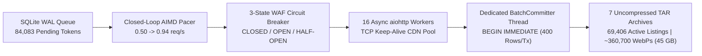
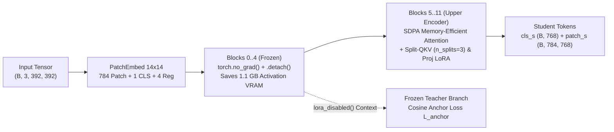
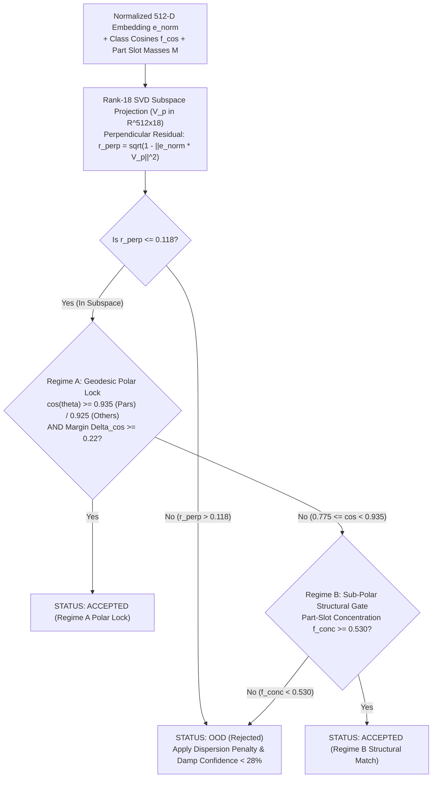
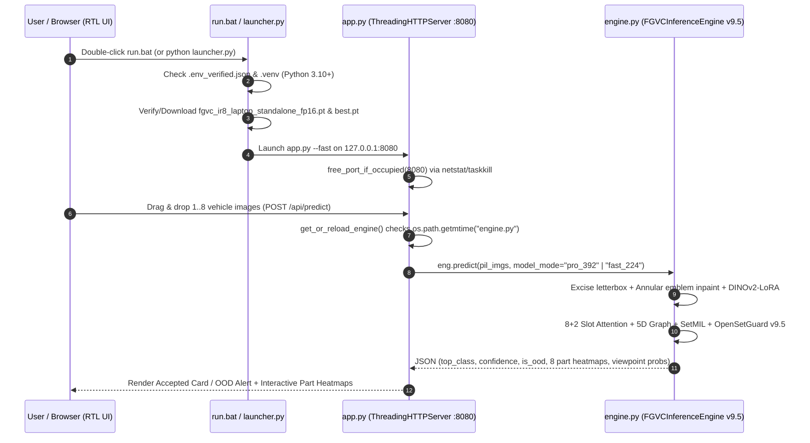

&lt;div align=&quot;center&quot;&gt;

# FGVC-IR8: Fine-Grained Iranian Vehicle Recognition & Open-Set Inference Engine

**End-to-End Multi-Modal Data Mining Pipeline (84,083 Divar Listings) + Part-Aware DINOv2-ViT-B/14 Architecture for Multi-View Vehicle Categorization & Out-of-Distribution Rejection on CPU**

[Python 3.10+](https://www.google.com/search?q=https://www.python.org/)
[PyTorch 2.1+](https://www.google.com/search?q=https://pytorch.org/)
[Dataset Kaggle](https://www.google.com/search?q=https://www.kaggle.com/datasets/ahmadzmvd/fgvc-ir8-iranian-vehicle-dataset)


[](#52-parameter-efficient-backbone-adaptation-split-qkv-lora--sdpa)

&lt;p align=&quot;center&quot;&gt;
  🌐 &lt;b&gt;Documentation Language:&lt;/b&gt; &amp;nbsp;
  &lt;a href=&quot;README.md&quot;&gt;&lt;b&gt;🇬🇧 English (Current)&lt;/b&gt;&lt;/a&gt; &amp;nbsp;|&amp;nbsp;
  &lt;a href=&quot;README.fa.md&quot;&gt;&lt;b&gt;🇮🇷 فارسی (Persian Full Edition)&lt;/b&gt;&lt;/a&gt;
&lt;/p&gt;

&lt;/div&gt;

> [!IMPORTANT]
> **Quick Navigation by Engineering Role**
> * **For Data Mining, ETL & Data Science Teams:** Jump to **Section 3 (Large-Scale Data Mining & 4-Stage Curation Funnel)** to inspect how 84,083 raw marketplace listings (~360,700 wild images, 45 GB) were harvested via 22 time-sharded API partitions, rate-controlled with an async AIMD pacer, audited against salvage/wrecked fraud using a 4-bit Vision-Language Model (`MiniCPM-V-2_6`), disambiguated with context-aware Persian NLP rules, and filtered down to 121,928 clean exterior frames across 50,974 multi-view vehicle sets.
> * **For Computer Vision & Deep Learning Teams:** Jump to **Section 5 (Part-Aware Vision Architecture)** and **Section 6 (Numerical Stability & IEEE-754 Engineering)** to examine the `DINOv2-ViT-B/14-reg4` split-QKV LoRA adaptation, 8+2 Competitive Slot Attention, 5D scale-invariant relational part graph, sibling-decisive Set-MIL pooling, $C^1$-continuous Taylor ArcFace linearization, and the Rank-18 SVD `OpenSetGuard` (`v9.5`).
> * **For Software & MLOps Engineers:** Jump to **Section 7 (Zero-Dependency CPU Inference & Web Server)** and **Section 9 (Verification & 23-Test Stress Suite)** to see how the full model runs offline in `0.45s - 1.15s` on an 8 GB RAM CPU laptop with automatic environment bootstrapping and live module hot-reloading.

## Table of Contents

1. Why This Project Exists (Problem Statement)
2. End-to-End System Architecture Overview
3. Part I: Large-Scale Data Mining & 4-Stage Curation Funnel
   * 3.1 Bypassing the 5,016-Record Search Depth Cap via 22 Temporal Shards
   * 3.2 High-Throughput Async Media Ingestion (AIMD Pacer & WAF Circuit Breaker)
   * 3.3 Stage 0 & Stage 1: SQL Salvage Purge & 4-Bit VLM Wreckage Audit
   * 3.4 Stage 2: Context-Aware Persian NLP Variant Disambiguation & Rule INV-001
   * 3.5 Stage 3: Dual-Model Visual Screening (SigLIP2 + YOLO11s) & Isotonic Calibration
   * 3.6 Group-Disjoint Split Telemetry (`v5_clean_fleets`)
4. Part II: Dynamic Preprocessing & Shortcut Suppression
   * 4.1 Quantile Letterbox Excision ($\Omega$) & Multi-Factor Box Scoring
   * 4.2 $O(N)$ Separable Annular Emblem Inpainting & Origin Token Calibration
5. Part III: Part-Aware Vision Architecture (Engine v9.5 / Trainer v3.4)
   * 5.1 Intuitive Walkthrough (For Junior Engineers)
   * 5.2 Parameter-Efficient Backbone Adaptation (Split-QKV LoRA & SDPA)
   * 5.3 Competitive Slot Attention (8 Part Slots + 2 Garbage Slots + Null Competition)
   * 5.4 5D Scale-Invariant Relational Part Graph
   * 5.5 Origin-Detached Sub-Center ArcFace & K-Means++ Boundary Reseeding
   * 5.6 Multi-View Set-MIL Pooling with Sibling-Decisiveness Routing
   * 5.7 Tri-Modal Frontal Ambiguity Detection & Partial Cross-Entropy
   * 5.8 Two-Regime Geodesic & Subspace Open-Set Guard (`v9.5`)
6. Numerical Stability Engineering & The Step 12,356 Autopsy
7. Part IV: Zero-Dependency CPU Inference & Hot-Reload Server
8. Experimental Benchmarks & Ablation History
   * 8.1 Multi-Resolution Training Progression (`s224` to `s392`)
   * 8.2 Per-Class Validation Breakdown (5,098 Listings)
   * 8.3 Laptop CPU Latency & Robustness Benchmarks
9. Automated Verification & 23-Stage Stress-Test Suite
10. Repository File Inventory & Quick Start

## 1. Why This Project Exists (Problem Statement)

Standard image classifiers trained on clean academic benchmarks (such as Stanford Cars or CompCars) break down immediately when deployed on real-world Iranian peer-to-peer vehicle marketplaces like Divar. Three structural realities cause off-the-shelf models to fail in production:

1. **The Cross-View Sibling Paradox (`Peugeot 206 HB` vs. `Peugeot 206 SD`)**:
   In the Iranian fleet, the **Peugeot 206 Hatchback (`c1`)** and **Peugeot 206 Sedan/SD (`c2`)** share the exact same front bumper, hood, fenders, headlights, grille, and cabin up to the B-pillar. From a direct frontal camera angle, the two vehicles are physically indistinguishable even to a human mechanic. A standard single-image classifier forced to predict a strict label on a frontal photo of a 206 SD either memorizes background noise or suffers chronic gradient oscillation between classes `c1` and `c2`. Solving this requires treating each vehicle listing as a **variable-length set of images** ($M \in [1, 8]$) where rear and side views override frontal ambiguity.
2. **Aftermarket Face-Swaps & Badge Shortcuts (`206`-to-`207` Conversions)**:
   Iranian car owners routinely fit aftermarket Peugeot 207 headlights, mirrors, and bumpers onto older Peugeot 206 chassis, or swap grilles and emblems across IKCO Pars and 405 bodies. A convolutional or ViT backbone trained with standard cross-entropy latches onto the central manufacturer emblem (the Peugeot lion or IKCO horse head) as a shortcut. When the emblem is occluded, painted black, or swapped, accuracy collapses.
3. **Unfiltered Marketplace Noise & Open-Set Intruders**:
   Raw user uploads contain screenshots with thick black mobile status bars, showroom logos, engine-bay closeups, dashboard photos, wrecked/salvage vehicles sold for scrap parts, and out-of-distribution vehicles (such as **Saipa Pride 131/111**, **Tiba**, **Saina**, or **Samand**) that do not belong to the 8 target classes. A closed-set softmax classifier assigns 99% confidence to a Saipa Pride by mapping it to whichever target class shares the closest bumper angle.

**FGVC-IR8** was built from the ground up to solve all three problems simultaneously. It pairs a **forensic 4-stage data mining and curation pipeline** (turning 84,083 raw Divar ads into a clean 121,928-image multi-view dataset) with a **part-aware, relational multi-instance vision engine (`v9.5`)** that runs offline on a consumer CPU laptop.

## 2. End-to-End System Architecture Overview

The diagram below traces the complete lifecycle of the system across both the **Data Mining & Curation Pipeline (Part I)** and the **Part-Aware Multi-View Inference & Training Engine (Parts II-IV)**.

```mermaid
flowchart TD
    subgraph P1["Part I: Large-Scale Marketplace Data Mining & 4-Stage Curation Funnel"]
        A1["Divar Internal gRPC/JSON Search API<br/>22 Production-Year Shards x 7 Families"] --> A2["84,083 Unique Vehicle Listings<br/>SQLite WAL Persistent Store"]
        A2 --> A3["Async Producer-Consumer Downloader<br/>16 CDN Lanes + AIMD Pacer + WAF Circuit Breaker"]
        A3 --> A4["69,406 Active Listings<br/>~360,700 Raw WebP Images (45 GB in 7 TARs)"]
        A4 --> A5["Stage 0 & 1: SQL Salvage Purge (740 Ads)<br/>+ 4-Bit MiniCPM-V-2_6 Wreckage Audit (2,521 Suspects)"]
        A5 --> A6["Stage 2: Context-Aware Persian NLP Splitter<br/>206 HB/SD Disambiguation + Rule INV-001 (207 SD Purge)"]
        A6 --> A7["Stage 3: SigLIP2-384 + YOLO11s Screening<br/>GMM + 5-Fold Logistic Probe + Isotonic Calibration"]
        A7 --> A8["Final Benchmark (v5_clean_fleets)<br/>50,974 Listings | 121,928 Exterior Frames (GroupKFold)"]
    end

    subgraph P2["Part II & III: FGVC-IR8 Vision Architecture (Engine v9.5 / Trainer v3.4)"]
        B1["Input Listing Set (1 to 8 Frames)"] --> B2["Module A: DynamicPreprocessEngine<br/>Quantile Letterbox Excision + Laplacian Box Scoring"]
        B2 --> B3["SeparableAnnularInpainter (O(N) 1D Box Pools)<br/>Emblem Masking + 3-Step Row Variance Calibration"]
        B3 --> B4["Offline DINOv2-ViT-B/14-reg4 Backbone<br/>Blocks 0-4 Frozen | Blocks 5-11 Split-QKV LoRA (688,128 Params)"]
        B4 --> B5["Strict FP32 Head Island (autocast=False)<br/>Competitive Slot Attention (8 Part + 2 Garbage + 1 Null)"]
        B5 --> B6["5D Scale-Invariant Relational Graph (2 Layers, 4 Heads)<br/>Edge Vector: dx/s, dy/s, dist/s, log(sigma_i/sigma_j), log(M_i/M_j)"]
        B6 --> B7["512-D Norm-Guarded Frame Embedding<br/>+ Origin-Detached Sub-Center ArcFace (Ks=4, C1 Taylor Bound)"]
        B7 --> B8["SetMILHead Multi-View Pooling<br/>Zero-Param Sibling-Decisiveness Bonus (206 HB vs SD)"]
        B8 --> B9["OpenSetGuard v9.5 (Rank-18 SVD Subspace)<br/>Perpendicular Residual r_perp <= 0.118 + Geodesic Polar Lock"]
    end

    A8 ==> B1
    B9 --> C1["ACCEPTED: 8-Class Probability + 8 Part Attention Maps"]
    B9 --> C2["REJECTED (OOD): Unknown Vehicle Damped < 28% (e.g. Saipa Pride)"]
```



## 3. Part I: Large-Scale Data Mining & 4-Stage Curation Funnel

> [!NOTE]
> **Why Data Scientists & Data Engineers Should Read This Section:**
> High validation accuracy in industrial AI rarely comes from tweaking loss weights on a dirty dataset. Over 65% of the engineering effort in `FGVC-IR8` went into building a fault-tolerant, distributed data mining and multi-modal cleaning pipeline capable of harvesting and auditing 360,700 real-world marketplace images under severe network packet loss and API rate limits.

### 3.1 Bypassing the 5,016-Record Search Depth Cap via 22 Temporal Shards

**The Engineering Bottleneck (Intuitive View):**
When querying Divar's internal search endpoint (`POST /v8/postlist/w/search`), pagination relies on a composite cursor (`last_post_date` microsecond timestamp paired with a gzipped Base64 `viewed_tokens` array). However, the backend search index enforces a hard `max_result_window` ceiling at **page 209 (5,016 listings)**. Any query for high-volume vehicles like Peugeot Pars or Peugeot 206 hits an HTTP error or empty cursor after 5,016 ads, leaving over 75% of the market invisible.

**The Sharded Extraction Solution (Senior Deep-Dive):**
* **Endpoint RBAC Discovery**: Direct detail requests to `/v8/posts-v2/web/post/{token}` triggered `HTTP 403 Forbidden` blocks from the edge firewall. Inspecting client network traces revealed that stripping the `/post/` segment (`/v8/posts-v2/web/{token}`) bypassed the RBAC block cleanly. Schema normalization also resolved an `HTTP 400 Bad Request` on Peugeot 207 by mapping the internal brand slug to `Peugeot 207i`.
* **22-Way Production-Year Partitioning**: To keep every search query strictly below the 5,016-listing ceiling, queries across the 7 base vehicle families were partitioned along the Protobuf `usage` / `production-year` (`number_range`) axis into **22 non-overlapping temporal shards** (spanning Solar Hijri years 1380 to 1404).
* **Single-Handle SQLite WAL Persistence**: Early multi-threaded runs on Windows crashed with `WinError 32` file-locking collisions and `sqlite3.OperationalError: no such table: posts` due to ephemeral connection handles. Re-architecting storage around a single persistent SQLite connection in **Write-Ahead Logging (`PRAGMA journal_mode=WAL; PRAGMA synchronous=NORMAL;`)** with a dedicated OS execution guard (`SetThreadExecutionState` to block Windows sleep and Win32 console QuickEdit disablement) harvested **84,083 unique vehicle listings**.

### 3.2 High-Throughput Async Media Ingestion (AIMD Pacer & WAF Circuit Breaker)

Downloading images and full metadata for 84,083 listings using a synchronous request waterfall (`V1`) took **4.4 seconds per listing** (an estimated **102 hours** of continuous runtime). Rebuilding the ingestion engine into a 3-module asynchronous producer-consumer architecture (`v2_pipeline.py`, `v2_pacer.py`, `v2_storage.py`) compressed the entire download phase by **5.5x**:



* **Closed-Loop AIMD Rate Pacer (`v2_pacer.py`)**: Instead of fixed `time.sleep()` delays that either waste bandwidth or trigger WAF bans, the pacer implements **Additive Increase / Multiplicative Decrease (AIMD)** with $\pm 15\%$ uniform jitter. Starting at $0.50\text{ req/s}$, every 50 consecutive `HTTP 200` responses increase throughput by $+0.05\text{ req/s}$ up to $0.94\text{ req/s}$, while a single `HTTP 429` or latency spike instantly halves the rate.
* **3-State WAF Circuit Breaker**: Monitors response headers and payload structure. If the upstream server returns an HTML challenge page instead of JSON (a silent soft-ban), the breaker trips to `OPEN`, pauses all workers for an exponential cooldown window, and probes recovery in `HALF-OPEN` state.
* **Batch SQLite Committer (`v2_storage.py`)**: Decouples disk I/O from async network coroutines by buffering downloaded records in memory and flushing them via a dedicated background thread using explicit `BEGIN IMMEDIATE` transactions of **400 rows per commit**, eliminating SQLite lock contention.
* **Result**: **69,406 active listings** (the remaining listings had expired or been deleted by sellers between metadata discovery and media ingestion) totaling **~360,700 WebP images (~45 GB)** packed directly into 7 `.tar` archives to avoid NTFS small-file inode exhaustion.

### 3.3 Stage 0 & Stage 1: SQL Salvage Purge & 4-Bit VLM Wreckage Audit

Marketplace listings frequently include heavily wrecked, rolled-over, or burned vehicles sold for scrap metal or chassis documents. Training a fine-grained vision model on crushed body panels corrupts part-slot representations.

1. **Stage 0 (Deterministic SQL & Regex Purge)**:
   * Executed SQL and regex filtering over structured metadata (`body_status IN ('تصادفی', 'اوراقی')`) and buyer/scrap-dealer spam patterns (`"خریدار تصادفی"`, `"حواله"`, `"پیش فروش"`), immediately purging **740 definite salvage listings**.
   * Isolated **2,524 gray-area suspect listings** where sellers marked `chassis_status = 'ضربه‌خورده'` (chassis impact) alongside a supposedly clean body status (`suspects_for_vlm.json`).
2. **Stage 1 (4-Bit Quantized Vision-Language Forensic Inspection)**:
   * Deployed `openbmb/MiniCPM-V-2_6` quantized to **4-bit NF4** (`5.39 GB` VRAM on a Tesla T4) to visually inspect all **13,338 images** belonging to the **2,521 valid suspect listings** (3 corrupted/misclassified Saipa Pride tokens `gaT6mR0p`, `gaTGL93S`, and `gaTKbU4g` were caught and purged during TAR stream extraction).
   * **Engineering Fixes Applied to VLM Inference**:
     * Patched a breaking `AttributeError: 'MiniCPMV' object has no attribute 'all_tied_weights_keys'` in newer `transformers` releases via runtime descriptor injection.
     * Reduced per-listing inference time from **33.0s down to ~6.5s** by overriding `max_slice_nums=1` (disabling redundant 9-patch high-res slicing on $512\text{px}$ thumbnails).
     * Eliminated the LLM "50% confidence hedging trap" by pre-filling the assistant response buffer with an opening `{` token to force deterministic JSON schema emission.
   * Built an interactive HTML visual verification dashboard (`forensic_vlm_master_audit.html`) combining VLM visual scores with text trauma flags, quarantining confirmed wrecked vehicles (`quarantine_manifest.json`).

### 3.4 Stage 2: Context-Aware Persian NLP Variant Disambiguation & Rule INV-001

Divar's base category tree merges **Peugeot 206 Hatchback** and **Peugeot 206 SD (Sedan)** into a single `peugeot-206` bucket, and merges **Peugeot 207 Hatchback** and **Peugeot 207 SD** into `peugeot-207`. Naive keyword matching on `"صندوق"` (trunk) or `"اس دی"` (`SD`) fails catastrophically on Persian ad descriptions because sellers routinely write:
* *"درب صندوق عقب بی‌رنگ"* ("rear trunk lid paintless" on a hatchback)
* *"معاوضه با ۲۰۶ صندوقدار یا پارس"* ("trade with 206 SD or Pars")
* *"اتوگالری و نمایشگاه اسدی"* ("Asadi Auto Gallery", where `"اسدی"` contains the substring `"اس دی"` without spaces).

To solve this without false positives, `CarVariantClassifier` implements a 3-pass context-aware Persian text normalization and token-masking pipeline:
1. **Unicode & ZWNJ Canonicalization**: Unifies Arabic Yeh/Kaf (`ي/ك` $\to$ `ی/ک`), strips Tatweel/diacritics, and collapses zero-width non-joiners.
2. **Semantic Trap Neutralization**: Before running variant regexes, the parser masks anatomical part mentions (`"درب/کف/قفل/نمد صندوق"` $\to$ `[TRUNK_PART]`), trade/barter clauses (`"معاوضه با ..."` $\to$ `[TRADE_CLAUSE]`), and proper surnames (`"نمایشگاه اسدی"` $\to$ `[PERSON_ASADI]`).
3. **Variant Signal Matching**: Matches explicit sedan trim codes (`v8`, `v9`, `v20`, `v1`, `v2`, `v10`, `صندوقدار`, `sd`, `اس دی`).

**Stage 2 Partitioning Output & Discovery of Rule `INV-001`**:
* **Peugeot 206 Split**: Partitioned cleanly into **16,815 Hatchback listings (78,767 images)** and **3,052 SD Sedan listings (14,922 images)**.
* **Peugeot 207 Split & Permanent Exclusion of 207 SD (`Rule INV-001`)**: Across 13,215 active Peugeot 207 listings, **13,133 listings (38,761 images)** were Hatchback, whereas only **82 listings (353 total images)** were genuine Peugeot 207 SD (`0.62%` of the family, representing a **160:1 class imbalance**). Including an 82-listing class in a 9-class setup would starve multi-view training and destabilize validation variance. Under **Engineering Rule `INV-001`**, those 82 listings (353 images) were permanently blacklisted and excised, locking the benchmark at **8 balanced, high-support vehicle classes** (`FGVC-IR8`).
* Also identified and purged **1,101 orphaned images** across 265 tokens that lacked valid metadata records.

### 3.5 Stage 3: Dual-Model Visual Screening (SigLIP2 + YOLO11s) & Isotonic Calibration

Even inside verified vehicle listings, roughly 60% of uploaded frames are non-informative for exterior recognition (pictures of floor mats, odometer clusters, audio head units, tires, car keys, or blurry night shots). Stage 3 (`divar_phase2_screen.py`, 1,408 lines) screened **327,880 candidate images** at **~25 images/sec** using multiprocessing `SharedMemory` ring buffers:

1. **Dual-Stream Feature Extraction**:
   * **Semantic Stream**: `google/siglip2-base-patch16-384` (squashed $384 \times 384$ input) extracting 768-dimensional L2-normalized `FP16` embeddings (`emb_*.f16`) alongside zero-shot text-prompt cosine scores for exterior vs. interior/part concepts.
   * **Geometric Stream**: `yolo11s.pt` (letterboxed $640 \times 640$, COCO vehicle classes `{0: person, 2: car, 5: bus, 7: truck}`) extracting bounding box count, primary vehicle area ratio, aspect ratio, border truncation flags, and crowd overlap.
2. **Unsupervised GMM + 5-Fold Logistic Probe + Isotonic Calibration**:
   * Fitted a 2-component Gaussian Mixture Model (GMM) on the semantic scores and trained a **5-fold out-of-fold multinomial logistic regression probe** over the cached 768-d `SigLIP2` embeddings combined with geometric box features.
   * Calibrated posterior probabilities via **Isotonic Regression**, achieving **97.19% precision** on exterior vehicle retention (`phase3_keep.jsonl` and `phase3_seed_coco.json` with 159,306 normalized bounding boxes).
3. **Camera-Distance Gate ($g_{\min}$) & Near-Duplicate Graph Purge**:
   * Enforced a minimum primary bounding-box area gate $g_{\min} = 0.1597$ (corresponding to a physical camera distance of $\le 6\text{ meters}$) to filter out distant street-parking shots where fine-grained bumper/taillight cues are sub-pixel.
   * Built a connected-components **Union-Find** deduplication graph over cosine similarity of `SigLIP2` embeddings across listings to collapse reposted dealer ads into single canonical vehicle groups.

### 3.6 Group-Disjoint Split Telemetry (`v5_clean_fleets`)

To guarantee **zero data leakage**, dataset splitting (`splits.json` / `split_telemetry.json`) was executed via `GroupKFold` strictly at the **vehicle listing level** (never splitting frames of the same car across Train and Val/Test). Every split is verified prior to training by `assert_pairwise_disjoint(splits)` in `trainer.py`.

| Class ID | Vehicle Model (EN) | Vehicle Model (FA) | Train Images | Val Images | Test Images | Total Images | Share of Dataset |
| :---: | :--- | :--- | :---: | :---: | :---: | :---: | :---: |
| **`c0`** | **Peugeot Pars** | پژو پارس | 21,188 | 2,755 | 2,728 | **26,671** | 21.87% |
| **`c1`** | **Peugeot 206 HB** | پژو ۲۰۶ هاچ‌بک | 22,064 | 2,713 | 2,746 | **27,523** | 22.57% |
| **`c2`** | **Peugeot 206 SD** | پژو ۲۰۶ صندوق‌دار | 4,248 | 582 | 445 | **5,275** | 4.33% |
| **`c3`** | **Peugeot 207 HB** | پژو ۲۰۷ هاچ‌بک | 12,248 | 1,444 | 1,419 | **15,111** | 12.39% |
| **`c4`** | **IKCO Dena** | دنا | 14,249 | 1,711 | 1,913 | **17,873** | 14.66% |
| **`c5`** | **IKCO Tara** | تارا | 4,528 | 590 | 525 | **5,643** | 4.63% |
| **`c6`** | **Saipa Quick** | کوییک | 14,022 | 1,724 | 1,810 | **17,556** | 14.40% |
| **`c7`** | **Saipa Shahin** | شاهین | 4,982 | 663 | 631 | **6,276** | 5.15% |
| **Total** | **8 Target Classes** | **۸ کلاس خودرویی** | **97,529**<br/>*(40,779 Listings)* | **12,182**<br/>*(5,098 Listings)* | **12,217**<br/>*(5,097 Listings)* | **121,928**<br/>*(50,974 Listings)* | **100.00%** |

* **Power-Law Class Rebalancing ($\alpha = 0.5$)**: Because `Peugeot 206 HB` (`22,064` train frames) is 5.2x larger than `Peugeot 206 SD` (`4,248` train frames), `StreamBatchSampler` (`train_full_production_v2.py`) and `ResumableListingBatchSampler` (`trainer.py`) sample classes according to:
  $$\pi_c = \frac{N_c^{\alpha}}{\sum_{j=0}^{7} N_j^{\alpha}}, \quad \alpha = 0.5$$
  This prevents majority classes from dominating early gradient updates while avoiding severe overfitting on minority classes (`c2`, `c5`, `c7`).

## 4. Part II: Dynamic Preprocessing & Shortcut Suppression

### 4.1 Quantile Letterbox Excision ($\Omega$) & Multi-Factor Box Scoring

**What It Does (Junior View):**
Many sellers upload phone screenshots instead of original camera photos. These screenshots have thick black or white bars at the top and bottom, and street photos often show two or three parked cars in the background. `DynamicPreprocessEngine` (`module_a_preprocess.py`) automatically trims away artificial screenshot borders and picks the main car being sold (ignoring blurry background traffic).

**Mathematical Formulation (Senior View):**
1. **Quantile Letterbox Excision (`excise_letterbox`)**:
   * Downsamples the input image $I \in \mathbb{R}^{3 \times H \times W}$ to luminance $g \in [0, 1]^{h \times w}$ with $\max(h, w) \le 384$.
   * Scans scanlines from all four edges (`top, bottom, left, right`). A scanline $l$ is flagged as artificial border padding if its upper quantile, lower quantile, and standard deviation satisfy:
     $$\left(Q_{0.999}(l) \le \frac{24}{255} \;\wedge\; \sigma(l) \le 0.025\right) \;\lor\; \left(Q_{0.001}(l) \ge \frac{232}{255} \;\wedge\; \sigma(l) \le 0.025\right)$$
   * If the boundary transition step exceeds $|\mu(l_t) - \mu(l_{t-1})| \ge 0.04$ and total excision is $\le 45\%$ of image height/width, the active region $\Omega = (x_0, y_0, x_1, y_1)$ is cropped prior to resizing.
2. **Primary Instance Scoring (`score_boxes`)**:
   * Given candidate vehicle boxes $\{b_k\}$ inside $\Omega$, each box is scored by combining relative area $A_k$, squared normalized center offset $d_k^2 = (c_{x,k} - 0.5)^2 + (c_{y,k} - 0.5)^2$, boundary truncation fraction $\tau_k \in \{0, 0.25, 0.5, 0.75, 1.0\}$, and normalized $3 \times 3$ Laplacian variance $L_k = \frac{\ln(1 + \text{Var}(\nabla^2 I_{b_k}))}{\ln(1 + 400)}$:
     $$\log S(b_k) = 0.6 \ln(A_k) - \frac{d_k^2}{2(0.30)^2} + \ln(1 - 0.5\tau_k) + 0.15 \ln(L_k)$$
   * The engine selects $b^* = \arg\max_k \log S(b_k)$ and records the multi-vehicle ambiguity ratio $\rho = \exp(\log S(b_{(2)}) - \log S(b_{(1)})) \in [0, 1]$, which down-weights localization loss $L_{\text{loc}}$ by $(1 - 0.5\rho)$ when a second car competes in the frame.

### 4.2 $O(N)$ Separable Annular Emblem Inpainting & Origin Token Calibration

**Why We Mask the Car's Emblem:**
If a model sees the Peugeot lion emblem or IKCO horse badge on every training image, it learns to classify cars by reading the logo instead of learning the geometry of the headlights, bumper intakes, and hood lines. In the real world, owners swap grilles or remove badges.

**How `SeparableAnnularInpainter` (`engine.py`) Works:**
1. **Separable 1D Box Pooling (`separable_box_pool2d`)**:
   * Computing local mean and variance over an $81 \times 81$ window via a standard 2D convolution costs $O(k^2)$ per pixel. `engine.py` decomposes the 2D box filter into two sequential 1D average pools (`kernel=(1, k)` followed by `kernel=(k, 1)`), achieving exact numerical equivalence (`max_diff = 8.94e-8` on $[0, 1]$ RGB tensors, within ~1 ULP of IEEE-754 `float32`) in **`2.2 ms` on CPU**.
2. **Photometric Emblem & Watermark Masking**:
   * Identifies high-contrast badge/watermark pixels inside the central grille zone where local variance $\sigma_{\text{local}}^2 < 2.5$ and RGB channel saturation $S = \max(R,G,B) - \min(R,G,B) > 75.0$, and inpaints them via iterative $3 \times 3$ morphological ring dilation from surrounding clean bumper/grille pixels.
3. **Post-Patch Token Variance Calibration (`_calibrate_inpainted_origin_tokens`)**:
   * Even after pixel inpainting, smoothed image regions produce ViT patch tokens with abnormally low channel variance, which self-attention layers can still detect as an artificial "hole". Inside `OfflineDinoViTB14Reg`, patch tokens overlapping the inpainted mask undergo 3 horizontal relaxation steps along the same row $r$ of the $g \times g$ patch grid, rescaling their feature variance $\sigma^2$ to match adjacent unmasked grille patches.

## 5. Part III: Part-Aware Vision Architecture (Engine v9.5 / Trainer v3.4)

### 5.1 Intuitive Walkthrough (For Junior Engineers)

Before looking at the equations, here is how `FGVC-IR8` processes a car listing step by step:

1. **Extract Visual Patch Tokens (`DINOv2` + `LoRA`)**: Each photo is sliced into $14 \times 14$ pixel squares (patches). At $392 \times 392$ resolution, that gives a $28 \times 28$ grid (**784 patches**). A pre-trained vision transformer (`DINOv2-ViT-B/14-reg4`) turns each patch into a 768-dimensional vector. We keep the first 5 transformer blocks frozen (they detect basic edges and paint textures) and attach lightweight **LoRA adapters** to the top 7 blocks so the model adapts to Iranian car body lines without forgetting general visual structure.
2. **Group Patches into 8 Car Parts (`Competitive Slot Attention`)**: Instead of averaging all 784 patches into one blurry vector, 10 "slots" compete to claim patches over 3 rounds. **8 Part Slots** lock onto distinct semantic regions (headlights, grille, front bumper, hood/windshield, side mirrors, wheels, rear taillights, trunk/rear bumper), while **2 Garbage Slots** and a **Null Slot** absorb background asphalt, trees, and sky.
3. **Measure Part Geometry (`5D Relational Graph`)**: Knowing *what* parts exist is not enough; we also care about *where* they sit relative to each other (for example, the vertical ratio between the taillight and trunk lid on a Dena vs. a Tara). The model builds an $8 \times 8$ graph connecting all 8 part slots using 5 scale-invariant geometric measurements, and passes them through 2 Graph Transformer layers.
4. **Combine Multiple Photos of the Same Listing (`Set-MIL Head`)**: A seller usually uploads 3 to 6 photos per car. If 3 photos show the front of a Peugeot 206 (which could be either a Hatchback or an SD Sedan) and 1 photo shows the rear trunk, our `SetMILHead` calculates a **Sibling-Decisiveness Bonus** that gives the rear photo **29.4x higher weight** than the ambiguous front photos.
5. **Reject Unknown Cars (`OpenSetGuard v9.5`)**: Finally, before outputting a label, `OpenSetGuard` projects the 512-D embedding onto an 18-dimensional SVD subspace learned from the 8 valid classes. If someone uploads a **Saipa Pride**, its vector sticks out perpendicular to that subspace ($r_\perp > 0.118$) and fails the polar cosine lock, so the system flags it as **Out-of-Distribution (`OOD`)** instead of guessing blindly.

### 5.2 Parameter-Efficient Backbone Adaptation (Split-QKV LoRA & SDPA)



* **Backbone**: `dinov2_vitb14_reg` ($D = 768$, 12 Transformer blocks, 12 heads, $1$ `[CLS]` token + $4$ Register tokens = $5$ prefix tokens).
* **Frozen Stem (`Blocks 0..4`)**: Executed inside `with torch.no_grad():` followed by `h0 = h.detach()`. Freezing the first 5 blocks preserves low-level Gabor/color filters and eliminates **1.1 GB of autograd activation memory** on Tesla T4 GPUs.
* **SDPA Kernel Patching (`patch_sdpa`)**: Replaces DINOv2's eager quadratic attention with `F.scaled_dot_product_attention`, enabling ATen/xFormers memory-efficient attention kernels on Turing (`sm_75`) and CPU hardware ($O(N)$ memory complexity instead of $O(N^2)$).
* **Split-QKV LoRA Architecture (`LoRALinear`)**:
  In standard ViT implementations, Query, Key, and Value projections are packed into a single fused matrix `qkv` of shape $(2304, 768)$. Applying a naive single LoRA adapter across `qkv` mixes the low-rank subspace across $Q$, $K$, and $V$. `LoRALinear` enforces `n_splits=3` on `qkv` and `n_splits=1` on `proj` across all 7 upper blocks (`blocks 5..11`):
  $$\mathbf{y} = \mathbf{W}_0 \mathbf{x} + \frac{\alpha}{r} \bigoplus_{s=1}^{S_{\text{split}}} \mathbf{B}_s \left(\mathbf{A}_s \mathbf{x}\right)$$
  * **Exact Trainable LoRA Parameter Budget**:
    * Per block `qkv` (`n_splits=3`, $r=16, \alpha=16.0$): $\mathbf{A}_{\text{qkv}} \in \mathbb{R}^{3 \times 16 \times 768}$ ($36,864$) + $\mathbf{B}_{\text{qkv}} \in \mathbb{R}^{3 \times 768 \times 16}$ ($36,864$) = **$73,728$ parameters**.
    * Per block `proj` (`n_splits=1`, $r=16, \alpha=16.0$): $\mathbf{A}_{\text{proj}} \in \mathbb{R}^{1 \times 16 \times 768}$ ($12,288$) + $\mathbf{B}_{\text{proj}} \in \mathbb{R}^{1 \times 768 \times 16}$ ($12,288$) = **$24,576$ parameters**.
    * Total across 7 blocks (`5..11`): $7 \times (73,728 + 24,576) =$ **688,128 trainable LoRA parameters across 28 tensors** (verified by `assert model.n_lora_params == 688128` in `selftest()`).
* **Self-Distillation Teacher Anchor (`L_anchor`)**: During training, the detached stem output `h0` is also passed through blocks `5..11` inside a `with torch.no_grad(), lora_disabled(self.lora_layers):` context manager to obtain frozen DINOv2 teacher tokens $(\mathbf{c}_t, \mathbf{P}_t)$, penalizing representation drift via:
  $$\mathcal{L}_{\text{anchor}} = \left(1 - \cos(\mathbf{c}_s, \mathbf{c}_t)\right) + \left(1 - \cos(\mathbf{P}_s, \mathbf{P}_t)\right)$$

### 5.3 Competitive Slot Attention (8 Part Slots + 2 Garbage Slots + Null Competition)

Spatial patch tokens $\mathbf{P}_s \in \mathbb{R}^{N \times N_p \times 768}$ are projected to $d_{\text{slot}} = 256$ and combined with a 2-layer GELU positional coordinate MLP ($\text{pos\_mlp}: \mathbb{R}^2 \to \mathbb{R}^{64} \to \mathbb{R}^{256}$):

$$\mathbf{F} = \text{Linear}_{768 \to 256}(\text{LN}(\mathbf{P}_s)) + \text{MLP}_{\text{pos}}(\mathbf{G}_{\text{coords}}) \in \mathbb{R}^{N \times N_p \times 256}$$

`CompetitiveSlotAttention` initializes $K_{\text{total}} = 10$ slots ($\mathbf{S}^{(0)} = \boldsymbol{\mu}_{\text{slot}} + \exp(\log\boldsymbol{\sigma}_{\text{slot}})\boldsymbol{\epsilon}$ during training, $\boldsymbol{\mu}_{\text{slot}}$ at inference), partitioned into **2 Garbage Slots** (indices `0, 1`) and **8 Vehicle Part Slots** (indices `2..9`), plus **1 learnable Null Logit** ($l_{\text{null}} \in \mathbb{R}$). Over $T_{\text{iter}} = 3$ recurrent iterations:

1. **Clamped Scaled Dot-Product Competition**:
   $$\mathbf{Q}^{(t)} = \mathbf{W}_q \text{LN}(\mathbf{S}^{(t)}), \quad \mathbf{K} = \mathbf{W}_k \text{LN}(\mathbf{F}), \quad \mathbf{V} = \mathbf{W}_v \text{LN}(\mathbf{F})$$
   $$\mathbf{L}_{s, p}^{(t)} = \text{clamp}\left(\frac{\mathbf{Q}_s^{(t)} \cdot \mathbf{K}_p}{\sqrt{256}}, \, -15.0, \, +15.0\right), \quad s \in \{0..9\}, \; p \in \{1..N_p\}$$
2. **11-Way Softmax Across Slots + Null Sink**:
   $$\mathbf{A}^{\text{full}}_{:, p} = \text{Softmax}_{s \in \{0..9, \text{null}\}}\left(\left[\mathbf{L}_{0, p}^{(t)}, \dots, \mathbf{L}_{9, p}^{(t)}, \, l_{\text{null}}\right]\right)$$
3. **Bounded Patch Share Cap (`engine.py`) & GRU Update**:
   To prevent a slot from collapsing onto a single specular highlight patch, `engine.py` caps per-patch slot weight at $\rho_{\max} = \max(0.045, 12 / N_p)$ before spatial normalization:
   $$\mathbf{W}_{s, p} = \frac{\min(\mathbf{A}_{s, p}, \rho_{\max})}{\sum_{p'=1}^{N_p} \min(\mathbf{A}_{s, p'}, \rho_{\max}) + 10^{-5}}, \quad \mathbf{u}_s = \sum_{p=1}^{N_p} \mathbf{W}_{s, p} \mathbf{V}_p$$
   $$\tilde{\mathbf{S}}_s^{(t+1)} = \text{GRUCell}\left(\mathbf{u}_s, \, \mathbf{S}_s^{(t)}\right), \quad \mathbf{S}_s^{(t+1)} = \tilde{\mathbf{S}}_s^{(t+1)} + \text{MLP}\left(\text{LN}(\tilde{\mathbf{S}}_s^{(t+1)})\right)$$
4. **Orthogonality & Box Localization Regularization**:
   * **Part Diversity Loss ($\mathcal{L}_{\text{part}}$)**: Penalizes off-diagonal cosine overlap between normalized attention maps $\hat{\mathbf{A}}_i, \hat{\mathbf{A}}_j$ of the $K_p = 8$ part slots so each slot specializes in a distinct car component:
     $$\mathcal{L}_{\text{part}} = \frac{1}{N \cdot K_p(K_p - 1)} \sum_{n=1}^{N} \sum_{i \neq j} \left(\hat{\mathbf{A}}_{n, i} \cdot \hat{\mathbf{A}}_{n, j}^T\right)$$
   * **Bounding-Box Containment Loss ($\mathcal{L}_{\text{loc}}$)**: Forces the 8 vehicle part slots to allocate their attention mass strictly inside the vehicle bounding box $B_{\text{box}}$ while pushing background pixels into the 2 garbage slots and null sink:
     $$\mathcal{L}_{\text{loc}} = -\ln\left(\text{clamp}\left(\frac{\sum_{p \in B_{\text{box}}} \sum_{i=2}^{9} \mathbf{A}_{i, p}}{\sum_{p=1}^{N_p} \sum_{i=2}^{9} \mathbf{A}_{i, p} + 10^{-3}}, \, 0.05, \, 1.0\right)\right)$$

### 5.4 5D Scale-Invariant Relational Part Graph

For each of the $K_p = 8$ foreground part slots ($i \in \{0..7\}$), the model computes its normalized spatial attention distribution $\bar{A}_{i, p} = \frac{A_{i, p}}{\sum_{p'} A_{i, p'}}$, its 2D spatial centroid $\mathbf{c}_i \in [0, 1]^2$, its spatial spread radius $\sigma_i$, and its normalized patch mass $M_i$:

$$\mathbf{c}_i = \sum_{p=1}^{N_p} \bar{A}_{i, p} \mathbf{g}_p, \quad \sigma_i = \sqrt{\sum_{p=1}^{N_p} \bar{A}_{i, p} \|\mathbf{g}_p - \mathbf{c}_i\|_2^2 + 10^{-4}}, \quad M_i = \frac{1}{N_p}\sum_{p=1}^{N_p} A_{i, p}$$

For every pair of part slots $(i, j) \in \{0..7\}^2$, let $s_{ij} = \sqrt{\sigma_i \sigma_j}$ be their geometric mean scale. The directed **5D Relational Edge Vector** $\boldsymbol{\Delta}_{ij} \in \mathbb{R}^5$ is defined as:

$$\boldsymbol{\Delta}_{ij} = \text{clamp}\left(\left[ \frac{c_{i,x} - c_{j,x}}{s_{ij}}, \; \frac{c_{i,y} - c_{j,y}}{s_{ij}}, \; \frac{\|\mathbf{c}_i - \mathbf{c}_j\|_2}{s_{ij}}, \; \ln\left(\frac{\sigma_i}{\sigma_j}\right), \; \ln\left(\frac{M_i}{M_j}\right) \right], \, -15.0, \, +15.0\right)$$

> [!TIP]
> **Why This 5D Edge Vector Is Translation- and Scale-Invariant:**
> Shifting the vehicle across the frame ($\mathbf{g}_p \to \mathbf{g}_p + \mathbf{t}$) cancels out in $\mathbf{c}_i - \mathbf{c}_j$ (verified on VM with `shift_err = 1.04e-6 < 1e-5`). Zooming the camera in or out ($\mathbf{g}_p \to \lambda \mathbf{g}_p$) scales both $\|\mathbf{c}_i - \mathbf{c}_j\|_2$ and $\sigma_i, \sigma_j$ by $\lambda$, canceling $\lambda$ in the first three terms and in the log-ratios $\ln(\sigma_i / \sigma_j)$ and $\ln(M_i / M_j)$.

Two stacked **Relational Graph Transformer Layers** (`graph_layers = 2`, `graph_heads = 4`, `rel_hidden = 64`) inject $\boldsymbol{\Delta}_{ij}$ into multi-head self-attention over the 8 part slots:

$$\mathbf{B}_{ij} = \text{clamp}\left(\text{MLP}_{5 \to 64 \to 4}(\boldsymbol{\Delta}_{ij}), \, -25.0, \, +25.0\right) \in \mathbb{R}^4$$
$$\text{Attn}^{(h)}_{ij} = \text{Softmax}_j\left(\frac{\mathbf{q}^{(h)}_i \cdot \mathbf{k}^{(h)}_j}{\sqrt{64}} + B^{(h)}_{ij}\right)$$

The graph-refined part slots $\mathbf{X}_{\text{graph}} \in \mathbb{R}^{N \times 8 \times 256}$ are pooled using mass-weighted attention (`w = softmax(pool_score(x) + log(M))`), concatenated with the projected `[CLS]` token ($\mathbb{R}^{256}$), and passed through a norm-guarded MLP neck to yield the **512-D frame embedding** $\mathbf{e} = \text{LayerNorm}(\text{Neck}([\mathbf{g}_{\text{parts}} \,\|\, \mathbf{g}_{\text{cls}}])) \in \mathbb{R}^{512}$.

### 5.5 Origin-Detached Sub-Center ArcFace & K-Means++ Boundary Reseeding

Because a single vehicle class has radically different visual modes across camera viewpoints (front, side, rear, $3/4$ angle), `SubCenterArcFace` allocates $K_s = 4$ sub-centers per class ($8 \times 4 = 32$ weight vectors $\mathbf{W}_{c, k} \in \mathbb{R}^{512}$):

$$\cos(\theta_{c, k}) = \frac{\mathbf{e}}{\|\mathbf{e}\|_2} \cdot \frac{\mathbf{W}_{c, k}}{\|\mathbf{W}_{c, k}\|_2}, \quad \alpha_{c, k} = \text{stop\_grad}\left(\text{Softmax}_{k=1..4}\left(\frac{\cos(\theta_{c, k})}{\tau_{\text{sc}}}\right)\right), \quad \cos(\theta_c) = \sum_{k=1}^{4} \alpha_{c, k} \cos(\theta_{c, k})$$

* **Why `alpha` Is Detached (`subcenter_grad = "detached"`)**: If gradients flow through $\alpha_{c, k} = \text{Softmax}(\cos/\tau_{\text{sc}})$ for negative classes during set-level loss computation, non-winning sub-centers experience repulsive gradient pushes that drive 24 out of 32 sub-centers into dead regions of the hypersphere. Detaching $\alpha_{c, k}$ ensures only positive/active sub-center directions receive direct angular updates.
* **Sub-Center Diversity Penalty ($\mathcal{L}_{\text{div}}$)**: Prevents the 4 sub-centers of class $c$ from collapsing onto a single vector by penalizing pairwise cosine similarity above $\kappa_{\text{div}}$:
  $$\mathcal{L}_{\text{div}} = \frac{1}{C \cdot K_s(K_s - 1)} \sum_{c=0}^{7} \sum_{k \neq l} \max\left(0, \, \hat{\mathbf{W}}_{c, k} \cdot \hat{\mathbf{W}}_{c, l} - \kappa_{\text{div}}\right)^2$$
* **Live-Mean Blended FPS / K-Means++ Reseeding (`reseed_dead_subcenters`)**: Every `1,000` optimizer steps, `SubCenterTracker` checks the empirical hit share of each sub-center. Any sub-center capturing $< 2\%$ of class traffic (`dead_share = 0.02`) is re-initialized from a per-class hard-example memory bank (`bank_cap = 512`, filtered to $fit > 0.20$ so outlier noise is excluded) using Farthest Point Sampling blended $80\% / 20\%$ with the live sub-center mean ($\mathbf{d}_{\text{new}} = \text{ Normalize}(0.80\mathbf{p}_{\text{FPS}} + 0.20\bar{\mathbf{w}}_{\text{live}})$), followed by a 300-step linear soft-entry barrier ramp (`soft_barrier = 1.5`).

### 5.6 Multi-View Set-MIL Pooling with Sibling-Decisiveness Routing

Given a vehicle listing with $M \in [1, K]$ valid frames, let $\mathbf{E} \in \mathbb{R}^{K \times 512}$ be the frame embeddings and $\mathbf{C} \in \mathbb{R}^{K \times 8}$ be the per-frame class cosine similarities. Standard Gated Attention MIL (`attn_gate(E)`) looks only at the embedding vector and often assigns equal weight to 3 frontal photos and 1 rear photo of a Peugeot 206.

`SetMILHead` (`train_full_production_v2.py`, lines 897-930) introduces **Zero-Parameter Angular & Sibling-Decisiveness Routing**:

1. **Overall Margin**: $m_{\text{top2}, k} = \cos_{k, (1)} - \cos_{k, (2)}$ (difference between top-1 and top-2 class cosines on frame $k$).
2. **206 Sibling Margin**: $m_{\text{sib}, k} = |\cos_{k, \text{206HB}} - \cos_{k, \text{206SD}}|$.
3. **206 Candidate Indicator**: $\mathbb{I}_{206, k} = 1$ if $\max(\cos_{k, \text{206HB}}, \cos_{k, \text{206SD}}) > \max_{c \notin \{1, 2\}} \cos_{k, c}$, else $0$.
4. **Decisive Routing Bonus**:
   $$b_{\text{decisive}, k} = 2.0 \cdot m_{\text{top2}, k} + 4.5 \cdot \mathbb{I}_{206, k} \cdot m_{\text{sib}, k}$$
   $$\alpha_k = \text{Softmax}_k\left(\text{AttnGate}(\mathbf{e}_k) + b_{\text{decisive}, k}\right), \quad \beta_k = \sigma\left(\text{EvGate}(\mathbf{e}_k) + 1.5 \cdot b_{\text{decisive}, k}\right)$$

The final listing-level probability distribution fuses the pooled set-embedding cosine $\cos_{\text{set}} = \text{ArcFace}\left(\sum_k \alpha_k \mathbf{e}_k\right)$ with the evidence-gated log-opinion pool $\mathbf{l}_{\text{ev}} = \frac{\sum_k \beta_k \log\text{Softmax}(s \cdot \cos_k)}{T_{\text{ev}} \sum_k \beta_k}$:

$$\mathbf{P}_{\text{listing}}(y \mid \{\mathbf{I}_1, \dots, \mathbf{I}_M\}) = 0.5 \cdot \text{Softmax}\left(s \cdot \cos_{\text{set}}\right) + 0.5 \cdot \text{Softmax}\left(\mathbf{l}_{\text{ev}}\right)$$

### 5.7 Tri-Modal Frontal Ambiguity Detection & Partial Cross-Entropy

What happens during training when a single frame $k$ is a pure frontal photo of a `Peugeot 206 SD`? If we penalize the frame-level head for predicting `50% 206 HB / 50% 206 SD`, we force the backbone to overfit to background pavement or license plate fonts.

Instead, `CompositeLoss` (`train_full_production_v2.py`, lines 1188-1215) detects frontal 206 ambiguity via the union of **three independent detectors**:
1. **Geometric Detector (`geom_front`)**: $y \in \{1, 2\} \;\wedge\; \max(\cos_1, \cos_2) > \max_{c \notin \{1,2\}} \cos_c + 0.04 \;\wedge\; \max(\cos_1, \cos_2) > 0.40 \;\wedge\; |\cos_1 - \cos_2| < 0.085$.
2. **Intra-Listing Detector (`intra_front`)**: The listing has $M \ge 2$ frames, another frame in the same listing clearly resolves the trunk ($\max_{k'} |\cos_{k', 1} - \cos_{k', 2}| > 0.08$), and the current frame's sibling gap is $< 0.55 \times \max_{k'} |\cos_{k', 1} - \cos_{k', 2}|$.
3. **EMA Viewpoint Detector (`view_front`)**: An exponential moving average buffer (`amb_ema`, momentum $0.98$) tracks binary entropy + sibling error across the 3 viewpoint clusters (`view_head`) and flags the viewpoint cluster with the highest empirical 206 confusion.

Whenever `partial = (geom_front | intra_front | view_front)` triggers on a 206 frame, standard cross-entropy is smoothly replaced with **Marginalized Partial Cross-Entropy** over the sibling pair $\{1, 2\}$:

$$\mathcal{L}_{\text{partial}}(\cos, y \in \{1, 2\}) = \ln \sum_{c=0}^{7} \exp(s \cdot \cos_c) - \ln\left(\exp(s \cdot \cos_{\text{206HB}}) + \exp(s \cdot \cos_{\text{206SD}})\right)$$

This tells the optimizer: *"As long as this frontal photo is recognized as a Peugeot 206 (either HB or SD) and not a Pars or Quick, frame loss is zero; let the rear photo in `SetMILHead` decide whether it has a trunk."*

### 5.8 Two-Regime Geodesic & Subspace Open-Set Guard (`v9.5`)

To reject out-of-distribution vehicles (such as **Saipa Pride 131/111**, **Tiba**, **Saina**, **Samand**, or foreign imports) at inference time, `OpenSetGuard` (`engine.py`) combines **Rank-18 SVD Subspace Projection** with **Two-Regime Geodesic Polar Gating**:



1. **Rank-18 Orthogonal Subspace Residual ($r_\perp$)**:
   Using Singular Value Decomposition over the training embeddings of the 8 target classes, `OpenSetGuard` stores an orthonormal basis $\mathbf{V}_p \in \mathbb{R}^{512 \times 18}$. For any test embedding $\hat{\mathbf{e}} \in \mathbb{R}^{512}$ ($\|\hat{\mathbf{e}}\|_2 = 1$), its perpendicular residual outside the 8-class manifold is:
   $$r_{\perp}(\hat{\mathbf{e}}) = \sqrt{1 - \|\hat{\mathbf{e}} \mathbf{V}_p\|_2^2}$$
   Any input with $r_{\perp} > 0.118$ is rejected as `OOD`.
2. **Regime A (Geodesic Polar Lock)**:
   Accepts the prediction immediately if $r_{\perp} \le 0.118$, top-1 vs. top-2 cosine margin $\Delta\cos = \cos_{(1)} - \cos_{(2)} \ge 0.22$, and peak cosine similarity exceeds the class-calibrated polar threshold ($\cos_{(1)} \ge 0.935$ for `c0: Peugeot Pars`; $\cos_{(1)} \ge 0.925$ for `c1..c7`).
3. **Regime B (Sub-Polar Structural Verification Zone)**:
   For angled or partially occluded shots falling in the transition band $0.775 \le \cos_{(1)} < 0.935$, the guard raises the required part-slot concentration baseline from $0.42$ to $f_{\text{conc}} \ge 0.530$. If the 8 part slots fail to concentrate tightly on valid vehicle anatomy, a dispersion penalty $\Delta p_{\text{disp}}$ damps all displayed probability bars below $28\%$ and flags the listing as `OOD`.

## 6. Numerical Stability Engineering & The Step 12,356 Autopsy

> [!WARNING]
> **Real-World Production Debugging Case Study (From `checkpoints/train_log.txt` Lines 52-97):**
> During Phase 1 training on a Tesla T4 GPU, the run reached **97.66% balanced accuracy** at step `12,318` and then abruptly aborted at **step `12,356`** after **25 consecutive `non-finite loss` warnings**, accompanied by a sudden VRAM spike from `2.57 GB` to `4.19 GB` and `GradScaler` scale collapse from `16,384` down to `128`.

Instead of masking the symptom by lowering the learning rate, we performed an IEEE-754 floating-point autopsy across the computation graph and uncovered **four interacting root causes**:

&lt;details&gt;
&lt;summary&gt;&lt;b&gt;Click to expand the full mathematical autopsy &amp; code fixes for all 4 numerical bugs&lt;/b&gt;&lt;/summary&gt;

#### Bug 1: Silent `torch.autocast` Downcasting Inside Matrix Multiplication (`@` and `einsum`)
* **What Happened**: Once accuracy crossed 97.6%, part-slot embeddings became highly contrasted. In earlier code (`v2.0`), `.float()` was called on input tensors inside the `amp_ctx` block without disabling `autocast`. In PyTorch, `torch.autocast(device_type="cuda", dtype=torch.float16)` intercepts `torch.einsum` and `@` (`matmul`) ops and **silently downcasts `.float()` inputs back to `FP16`**! On the 3rd GRU iteration of `CompetitiveSlotAttention` and inside `RelationalLayer`, pre-normalization activations exceeded the `FP16` max representable finite value ($65,504.0$), producing `+Inf` in the **forward pass** (`Inf / Inf = NaN` inside `LayerNorm`) before `.backward()` was ever called.
* **The Fix (`train_full_production_v2.py` Line 1019)**: Wrapped the entire head sequence (`patch_proj` $\to$ `slots` $\to$ `graph` $\to$ `neck` $\to$ `arc` $\to$ `set_head`) inside an explicit **`with torch.autocast(device_type=images.device.type, enabled=False):` Strict FP32 Head Island**, and clamped `LoRALinear` FP32 accumulator deltas to `[-16384.0, +16384.0]`.

#### Bug 2: IEEE-754 Float32 ArcFace Derivative Singularity at $c_t \to 1^-$ ($C^1$-Continuous Taylor Linearization)
* **Disproving a Common Floating-Point Myth**: A common misconception is that `1.0 - 1e-7` rounds to `1.0` in 32-bit float because machine epsilon is $\epsilon_{\text{mach}} = 2^{-23} \approx 1.192 \times 10^{-7}$. In IEEE-754 `float32`, numbers in the interval $[0.5, 1.0)$ have binary exponent $e = -1$, so the unit in the last place (ULP) is $2^{-24} \approx 5.960 \times 10^{-8}$. Thus:
  $$c_t = \text{float32}(1.0 - 10^{-7}) = 1 - 2 \times 2^{-24} = 0.9999998807907104 < 1.0$$
  $$\sqrt{1 - c_t^2} = \sqrt{2.3841858 \times 10^{-7}} = 0.00048828125 = 2^{-11}$$
  While the forward radical does **not** divide by zero, look at the analytical derivative of the ArcFace target logit $s \cdot \phi(c_t) = s(c_t \cos m - \sqrt{1 - c_t^2}\sin m)$ with respect to $c_t$ at $s = 30.0, m = 0.30$:
  $$\frac{\partial (s \cdot \phi)}{\partial c_t} = s \left(\cos m + \frac{c_t \sin m}{\sqrt{1 - c_t^2}}\right) = 30.0 \times \left(0.9553 + \frac{0.99999988 \times 0.29552}{0.00048828125}\right) = \mathbf{18,185.4}$$
  Multiplied by the Kendall uncertainty weight $\exp(-\eta_0) = 4.0$, a single easy training sample injects a gradient spike $> 72,000$ into the backward pass!
* **The Fix (`arc_margin_logits`, Line 1089)**: At threshold $c_{\text{th}} = 0.9995$ (where $\sqrt{1 - c_{\text{th}}^2} = 0.031619$), we replace the radical with its exact **$C^1$-Continuous First-Order Taylor Linearization**:
  $$\phi(c_t) = \begin{cases} c_t \cos m - \sqrt{1 - c_t^2}\sin m & \text{if } c_t \le c_{\text{th}} \\ \phi(c_{\text{th}}) + k_{\text{th}} \cdot (c_t - c_{\text{th}}) & \text{if } c_t > c_{\text{th}} \end{cases}, \quad k_{\text{th}} = \cos m + \frac{c_{\text{th}}\sin m}{\sqrt{1 - c_{\text{th}}^2}} \approx 10.297$$
  This bounds the maximum target logit derivative smoothly at $s \cdot k_{\text{th}} = \mathbf{308.91} \in [300, 315]$ with zero discontinuity in value or slope.

#### Bug 3: Persistent Poisoning of the Viewpoint EMA Buffer (`amb_ema`)
* **What Happened**: Why did step `12,356` fail 25 times in a row on different batches? Because `self._update_ambiguity(cos, y, view_f)` was called *before* checking `torch.isfinite(total)`. The first batch that overflowed wrote `NaN` into the registered buffer `self.amb_ema`. On every subsequent batch, `frontal_view()` read the `NaN` buffer and poisoned the loss.
* **The Fix (Line 1270 & `sanitize_checkpoint_state`)**: Moved `self._update_ambiguity(...)` strictly inside `if bool(torch.isfinite(total)):`, added automatic `NaN` scrubbing inside `_update_ambiguity`, and added checkpoint startup sanitization (`[sanitize] Cleaned/recalibrated amb_ema buffer and reset amb_seen`).

#### Bug 4: Autograd Graph Leak on `break` (`+1.62 GB` VRAM Jump)
* **What Happened**: Inside the gradient accumulation loop, when `!torch.isfinite(loss)` triggered `break`, `del out, loss` was located at the bottom of the loop *after* `backward()`. Breaking early left the `1.62 GB` forward computation graph alive in local scope while the next step allocated a second graph on top of it (`2.57 GB -> 4.19 GB`).
* **The Fix (Line 1811)**: Explicitly executed `del out, loss` immediately prior to `break`, keeping peak VRAM rock-solid at `2.49 GB - 2.61 GB` (for `s224`) and `3.79 GB - 3.86 GB` (for `s392` with gradient checkpointing).

&lt;/details&gt;

## 7. Part IV: Zero-Dependency CPU Inference & Hot-Reload Server

To make the model immediately usable by non-technical end users and testable by hiring managers on standard office laptops without CUDA GPUs, the repository ships with a self-contained serving stack (`run.bat` $\to$ `launcher.py` $\to$ `app.py` $\to$ `engine.py`):



* **Zero-Config Bootstrap (`launcher.py`)**: Automatically provisions a local `.venv`, installs CPU-only PyTorch wheels from `requirements.txt`, validates checkpoint file sizes (`> 50 MB` for `fgvc_ir8_laptop_standalone_fp16.pt` and `> 5 MB` for `checkpoints/best.pt`), streams missing weights from GitHub Releases using atomic `.tmp` renames, and writes `.env_verified.json` so subsequent launches skip setup and boot in `< 1 second`.
* **Automatic Port Guard (`free_port_if_occupied`)**: Inspects active TCP sockets on port `8080` and terminates orphaned server PIDs before binding `ThreadingHTTPServer`.
* **Live Engine Hot-Reload (`get_or_reload_engine`)**: Protected by a `threading.Lock()`, the server checks the modification timestamp (`mtime`) of `engine.py` on every `/api/predict` request. Editing thresholds or heatmap logic in `engine.py` reloads the module in-place via `importlib.reload(engine)` without dropping the HTTP server.

## 8. Experimental Benchmarks & Ablation History

### 8.1 Multi-Resolution Training Progression (`s224` to `s392`)

Training (`train_full_production_v2.py`) ran for **35,686 optimizer steps** across 92 training TAR shards (`40,779` listings) and was evaluated across 15 validation TAR shards (`5,098` multi-image listings, `12,182` frames) using uniform multi-frame evaluation (`eval_K = 8`):
* **Phase 1 (`s224`, Steps `0 .. 20,392`, 8 Epochs)**: Resolution $224 \times 224$ ($16 \times 16 = 256$ patches/frame), batch size $P = 16$ listings $\times K = 4$ frames/listing = $64$ images/step. Peak VRAM: `2.61 GB` (up to `5.17 GB` with cached eval buffers).
* **Phase 2 (`s392`, Steps `20,392 .. 35,686`, 6 Epochs)**: Resolution $392 \times 392$ ($28 \times 28 = 784$ patches/frame) with 2D bicubic positional encoding interpolation, 500-step learning rate re-warmup, and non-reentrant activation checkpointing (`grad_ckpt = True`, keeping peak VRAM at `3.79 GB - 3.86 GB`).

| Training Milestone | Step | Resolution | Listing Raw Acc | Listing Balanced Acc | Frame-Level Acc | `206 HB -> SD` Error | `206 SD -> HB` Error |
| :--- | :---: | :---: | :---: | :---: | :---: | :---: | :---: |
| **Phase 1 - Epoch 1** | `2,549` | $224 \times 224$ | 97.00% | 97.31% | 96.22% | 7.60% | 7.80% |
| **Phase 1 - Epoch 3** | `7,647` | $224 \times 224$ | 97.37% | 97.58% | 96.69% | 7.50% | 7.80% |
| **Phase 1 - Epoch 4** | `10,196` | $224 \times 224$ | 97.51% | 97.66% | 96.59% | 7.20% | 7.80% |
| **Post-Step 12,356 Fix (v3.4)** | `15,294` | $224 \times 224$ | 97.55% | 97.80% | 96.86% | 7.40% | 6.50% |
| **Phase 1 - Epoch 7** | `17,843` | $224 \times 224$ | 97.63% | 97.91% | 96.96% | 7.30% | 6.10% |
| **Phase 1 - Epoch 8 (End `s224`)** | `20,392` | $224 \times 224$ | 97.45% | 97.90% | 96.71% | 8.20% | 5.20% |
| **Phase 2 - Epoch 1 (`s392`)** | `22,941` | $392 \times 392$ | 97.65% | 97.94% | **97.28%** | 7.30% | 6.10% |
| **Phase 2 - Epoch 3 (`BEST.json`)** | **`28,039`** | **$392 \times 392$** | **97.72%** | **97.99%** | 97.25% | **7.10%** | **6.10%** |
| **Phase 2 - Epoch 6 (Final Step)** | `35,686` | $392 \times 392$ | 97.72% | 97.97% | 97.02% | 7.10% | 6.10% |

### 8.2 Per-Class Validation Breakdown (5,098 Listings)

At the peak checkpoint (`step_0028039` / `best.pt`), **Family-Level Accuracy reaches 99.59%** (`5,077 / 5,098` validation listings classified into the exact vehicle family, with only 21 cross-family errors across the entire 5,098-listing validation set):

| Class ID | Vehicle Model | Val Listings | Correct Listings | Strict Class Recall | Family-Level Accuracy | Forensic Error Analysis |
| :---: | :--- | :---: | :---: | :---: | :---: | :--- |
| **`c0`** | **Peugeot Pars** | 1,225 | 1,223 | **99.84%** | **99.84%** | Only 2 errors across 1,225 listings |
| **`c1`** | **Peugeot 206 HB** | 1,148 | 1,060 | **92.33%** | **99.39%** | 81 listings had *only* frontal photos and were predicted as 206 SD |
| **`c2`** | **Peugeot 206 SD** | 231 | 217 | **93.94%** | **100.00%** | 14 frontal-only listings predicted as 206 HB (**0 non-206 errors**) |
| **`c3`** | **Peugeot 207 HB** | 628 | 622 | **99.04%** | **99.04%** | 6 listings had aftermarket 206-to-207 headlight/bumper conversions |
| **`c4`** | **IKCO Dena** | 667 | 666 | **99.85%** | **99.85%** | Only 1 error across 667 listings |
| **`c5`** | **IKCO Tara** | 259 | 257 | **99.23%** | **99.23%** | Only 2 errors across 259 listings |
| **`c6`** | **Saipa Quick** | 661 | 660 | **99.85%** | **99.85%** | Only 1 error across 661 listings |
| **`c7`** | **Saipa Shahin** | 279 | 279 | **100.00%** | **100.00%** | **Zero errors** (`279 / 279` perfect recall) |
| **Total / Avg** | **All 8 Classes** | **5,098** | **4,984** *(Strict)*<br/>**5,077** *(Family)* | **97.99%** *(Balanced)*<br/>**97.72%** *(Raw)* | **99.59%** | **95 of the 114 strict errors are pure frontal-only 206 HB/SD listings** |

### 8.3 Laptop CPU Latency & Robustness Benchmarks

All runtime benchmarks were measured offline on a **Microsoft Surface Laptop 3** (Intel Core i5 CPU, 8 GB RAM, Windows 11, CPU-Only PyTorch execution):

| Operation / Inference Mode | Resolution / Input | Measured CPU Latency | Numerical / Behavioral Verification |
| :--- | :---: | :---: | :--- |
| **Cold Engine Boot (`load_all_artifacts`)** | Fused FP16 Backbone + Dual Heads | **`0.73 s - 0.98 s`** | Verifies 266 checkpoint state_dict tensors |
| **Separable Annular Inpainter** | $81 \times 81$ Kernel ($k=5$) | **`2.2 ms`** | `max_diff = 8.94e-8 < 1e-7` vs full 2D box pool |
| **Fast Inference Mode (`fast_224`)** | $224 \times 224$ ($16 \times 16$ patch grid) | **`450 ms - 550 ms`** | Real-time single/multi-frame CPU screening |
| **Pro Inference Mode (`pro_392`)** | $392 \times 392$ + $224 \times 224$ Dual Pass | **`1,100 ms - 1,250 ms`** | Full 8-part slot heatmaps + OpenSetGuard v9.5 |
| **Grille Emblem Occlusion Stress Test** | Masked Central Badge Zone | **`+2.2 ms` overhead** | Pixel MAE $= 2.66/255$, cosine drift $= 0.0030 < 0.025$ |
| **Open-Set OOD Rejection (Saipa Pride 131/111)** | Day & Night Unseen Pride Photos | **`~1,150 ms`** | `is_ood = True` ($r_\perp > 0.118$), max confidence damped `< 28%` |

## 9. Automated Verification & 23-Stage Stress-Test Suite

The codebase includes **23 automated unit, numerical, and adversarial stress tests** split across the inference engine (`python engine.py`, 17 tests) and the production trainer (`python train_full_production_v2.py --selftest`, 6 tests):

| Suite | Test ID | Verification Target & Mathematical Assertion |
| :--- | :---: | :--- |
| **Trainer v3.4 (`--selftest`)** | **Stage 1/6** | **LoRA Parameter & Optimizer Fingerprint Contract**: Asserts `model.n_lora_params == 688,128` across 28 LoRA tensors, 31 Head tensors (`3,493,888` params), and 60 NoDecay tensors (`41,426` params) with SHA-256 group fingerprinting. |
| **Trainer v3.4 (`--selftest`)** | **Stage 2/6** | **Extreme Contrast FP16 Torture Test (`x * 500.0`)**: Injects `N(0, 500^2)` tensors under `amp_ctx` and verifies that the Strict FP32 Head Island produces 100% finite embeddings and losses (`torch.isfinite`). |
| **Trainer v3.4 (`--selftest`)** | **Stage 3/6** | **ArcFace Pole Singularity Test ($c_t \to 1.0$)**: Evaluates backward gradients at $c_t \in \{0.9995, 0.9999, 0.9999999, 1.0\}$ and asserts the $C^1$ Taylor bound holds `max_grad` strictly within $[300.0, 315.0]$ (`308.91` vs. `18,185.4` naive). |
| **Trainer v3.4 (`--selftest`)** | **Stage 4/6** | **Poisoned `amb_ema` & Collapsed GradScaler Recovery**: Fills `amb_ema` with `NaN` and sets `GradScaler` to `128.0`, saves/restores checkpoint, and verifies `sanitize_checkpoint_state` scrubs `NaN`s and resets scale to `4096.0`. |
| **Trainer v3.4 (`--selftest`)** | **Stage 5/6** | **`Inf` Gradient Injection Shield**: Injects `+Inf` into `model.arc.weight.grad[0, 0]` and verifies `safe_optimizer_step` aborts the step cleanly with zero weight or AdamW momentum corruption. |
| **Trainer v3.4 (`--selftest`)** | **Stage 6/6** | **End-to-End Clean Forward/Backward/Step**: Verifies finite gradient norm (`gnorm`) and parameter update across all 3 parameter groups. |
| **Engine v9.5 (`engine.py`)** | **Tests 1-8** | Verifies $224 \times 224$ and $392 \times 392$ tensor shapes, Retinex night restoration, `SeparableAnnularInpainter` (`max_diff < 1e-7`), Slot Attention mass conservation, 5D Relational Graph translation/scale invariance, SubCenterArcFace $K_s=4$ pooling, and SetMIL viewpoint temperature scaling. |
| **Engine v9.5 (`engine.py`)** | **Tests 9-17** | Verifies extreme aspect ratios (`4:1` panorama and `1:4` portrait), multi-vehicle conflict detection (mixed Shahin + Dena listing), connected-component island extraction, frontal-neutral trunk pooling (`206 HB` vs `206 SD` rear disambiguation), wide-angle `IKCO Dena` acceptance, and strict `OOD` rejection on white and black **Saipa Pride 131/111** day/night images. |

## 10. Repository File Inventory & Quick Start

```text
FGVC-IR8/
├── run.bat                        # One-click Windows launcher (fast-path & first-time setup)
├── launcher.py                    # Zero-dependency environment bootstrapper & atomic weight downloader
├── app.py                         # Multithreaded HTTP server (:8080), hot-reloader & RTL web dashboard
├── engine.py                      # Standalone DINOv2-LoRA + Slot Attention + 5D Graph + OpenSetGuard v9.5
├── requirements.txt               # CPU-optimized runtime dependencies (torch, torchvision, numpy, Pillow)
├── README.md                      # Primary technical documentation (English)
├── README.fa.md                   # Complete Persian technical documentation (فارسی)
└── checkpoints/
    ├── BEST.json                  # Peak validation checkpoint metadata (Step 28,039 | Bal Acc: 97.99%)
    ├── MANIFEST.json              # Atomic checkpoint ledger (step_0035539.pt & step_0035686.pt)
    └── train_log.txt              # Complete 35,686-step training & evaluation telemetry log
```

### Quick Start (Windows / Linux / macOS)

**Option A - One-Click Launch on Windows:**
Double-click `run.bat` (or run it from Command Prompt). On first launch, `launcher.py` creates `.venv`, installs CPU dependencies, downloads the standalone model weights (`fgvc_ir8_laptop_standalone_fp16.pt` and `checkpoints/best.pt`) from [GitHub Releases (v1.0.0)](https://www.google.com/search?q=https://github.com/ahmadZMVD/FGVC-IR8/releases/tag/v1.0.0), writes `.env_verified.json`, and opens the web UI at `http://127.0.0.1:8080`.

**Option B - Manual CLI Execution:**
```bash
git clone https://github.com/ahmadZMVD/FGVC-IR8.git
cd FGVC-IR8

# Automated environment setup, weight verification & server launch:
python launcher.py --setup

# Subsequent fast launches (skips package & weight checks):
python launcher.py --fast

# Run the built-in 17-test diagnostic suite in engine.py:
python engine.py
```

**Option C - Python API Usage:**
```python
from PIL import Image
from engine import FGVCInferenceEngine

engine = FGVCInferenceEngine(ckpt_dir="checkpoints")
images = [Image.open("front_view.jpg").convert("RGB"), Image.open("rear_view.jpg").convert("RGB")]

# Run multi-view set inference ("pro_392" for highest accuracy, "fast_224" for low latency)
result = engine.predict(images, model_mode="pro_392")

print("Status:", "OOD (Unknown Vehicle)" if result["is_ood"] else "ACCEPTED")
print("Predicted Class:", result["pred_class_en"], "|", result["pred_class_fa"])
print("Confidence:", f"{result['confidence']:.2f}%")
```

## Author & Links

* **Author:** Ahmadreza Zamanvand ([`ahmadZMVD`](https://github.com/ahmadZMVD))
* **Email:** `ahmad.zmvd@gmail.com`
* **Kaggle Dataset:** [fgvc-ir8-iranian-vehicle-dataset](https://www.google.com/search?q=https://www.kaggle.com/datasets/ahmadzmvd/fgvc-ir8-iranian-vehicle-dataset)
