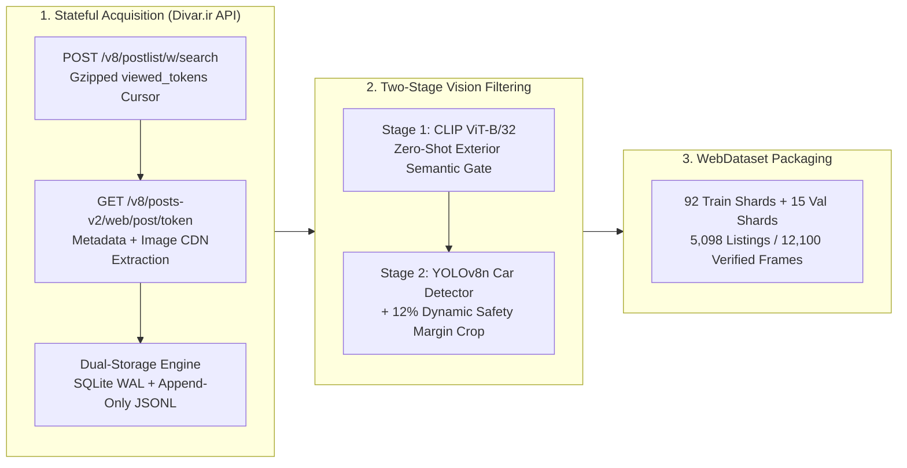
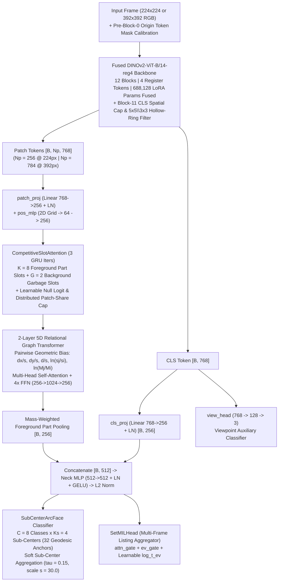
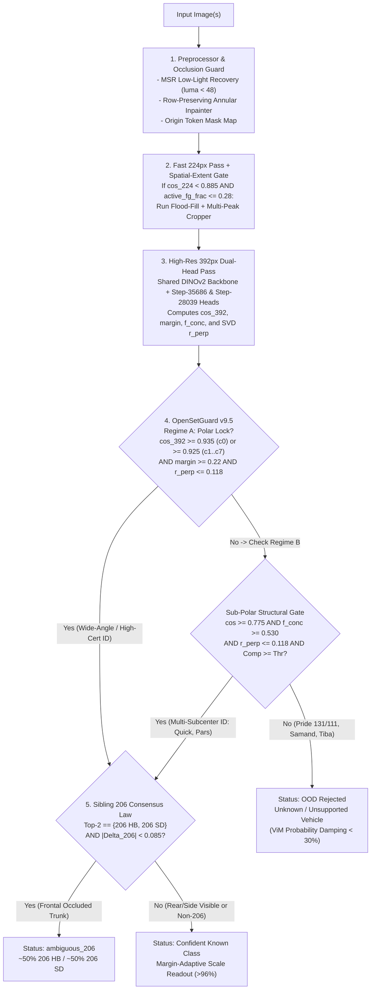

&lt;div align=&quot;center&quot;&gt;

# FGVC-IR8 (`v9.5`)
### Fine-Grained Iranian Vehicle Categorization & Open-Set Recognition Engine

[Release](https://www.google.com/search?q=https://github.com/ahmadZMVD/FGVC-IR8/releases/tag/v1.0.0)
[](https://www.python.org/)
[](https://pytorch.org/)
[](https://github.com/facebookresearch/dinov2)
[](https://github.com/ahmadZMVD/FGVC-IR8/blob/main/checkpoints/BEST.json)
[](https://github.com/ahmadZMVD/FGVC-IR8/blob/main/engine.py)
[](https://github.com/ahmadZMVD/FGVC-IR8/blob/main/README.md)

**A zero-dependency, CPU-native Fine-Grained Visual Categorization (FGVC) and Open-Set Recognition (OSR) system engineered for real-world Iranian automotive marketplaces.**

**8 Target Vehicle Classes** • **DINOv2-ViT-B/14-reg4 + 28-Tensor LoRA** • **8+2 Competitive Slot Attention** • **5D Relational Graph** • **Two-Regime OpenSetGuard (`v9.5`)** • **Bilingual (`EN` / `FA`) Documentation**

&lt;/div&gt;

> [!IMPORTANT]
> **What's New in Engine `v9.5` (17-Stage Verified Release):**
> - **Exact 266-Tensor Checkpoint Compatibility (`StandaloneFGVCModel`):** 100% strict `state_dict` parity with both `fgvc_ir8_laptop_standalone_fp16.pt` (Step `35,686`) and `best.pt` (Step `28,039`, `97.99%` balanced validation accuracy) for zero-copy dual-head inference on a single shared `DINOv2` backbone pass.
> - **Two-Regime Geodesic & Structural `OpenSetGuard` (`v9.5`):** Decouples high-certainty 392px Geodesic Polar Locks ($\cos_{392} \ge 0.935$ on `c0` or $\ge 0.925$ on `c1..c7`) from part-slot spatial dispersion penalties—eliminating false OOD rejections on wide-angle full-frame vehicles (such as *IKCO Dena* at $\cos = 0.9701, f_{\text{conc}} = 0.221$) while tightening sub-polar structural verification ($f_{\text{conc}} \ge 0.530, r_\perp \le 0.118$) to reject every *Saipa Pride 131 / 111 / Saba* impostor across daylight and night frames.
> - **Spatial-Extent & Cosine-Gated Autonomous Cropper:** Evaluates candidate connected-component islands only when base 224px confidence is inconclusive ($\cos_{224} \lt  0.885$) **and** active foreground attention occupies a compact subregion ($\text{active\_fg\_frac} \le 0.28$), reducing full-frame inference latency by **~55%**.
> - **Zero-Friction Port-8080 Lifecycle & Hot-Reloading (`app.py v9.5`):** Automatically terminates stale processes holding port `8080` before binding and hot-reloads `engine.py` in memory when updated.

## 1. Problem Formulation & Real-World Failure Modes

Standard closed-set Vision Transformers trained on curated academic benchmarks fail catastrophically when deployed on uncurated consumer vehicle listings (such as **Divar.ir**). **FGVC-IR8** is architected from first principles to resolve four coupled real-world failure modes simultaneously:

| # | Failure Mode | Root Cause in Standard Models | FGVC-IR8 (`v9.5`) Architectural Solution |
| :-: | :--- | :--- | :--- |
| **1** | **Sibling-Class Viewpoint Ambiguity** (`Peugeot 206 HB` vs. `206 SD`) | `Peugeot 206 Hatchback (c1)` and `Peugeot 206 SD Sedan (c2)` share identical front bumpers, headlights, hoods, and grilles. Under a `5.2 : 1` market listing imbalance favoring `206 HB`, purely frontal photos (where the rear trunk is occluded) collapse onto `206 HB` at `>95%` confidence. | **Symmetric Cross-Scale Consensus Law & Frontal-Neutral Trunk Pooling:** Detects trunk occlusion via cross-scale (224px vs. 392px) sibling margin bounds ($\lvert\Delta_{206}\rvert \lt  0.085$), outputting a transparent `ambiguous_206` (~50/50) state on single frontal frames while pooling exclusively from rear/side frames in multi-photo uploads. |
| **2** | **Adversarial Shortcut Learning on Badges & Plates** | ViT self-attention collapses onto 1–3 patches containing high-contrast brand emblems or license plates. Covering or swapping a grille badge causes massive embedding drift ($\Delta_{\cos} \gt  0.12$). | **Row-Preserving Annular Inpainter + Pre-Block-0 Origin Token Calibration + Hollow-Ring ($5\times 5 \setminus 3\times 3$) Spike Filter:** Replaces horizontal scanline bands with variance-restored background texture, blends masked patch embeddings with calibrated origin tokens before Block 0, and caps per-patch slot share at $\max(0.045, 12/N_p)$ ($\Delta_{\cos} \lt  0.015$). |
| **3** | **Closed-Set Softmax Overconfidence on OOD Vehicles** | Closed-set Softmax forces probabilities across the 8 target classes to sum to `100%`. Uploading ubiquitous out-of-distribution vehicles (*Saipa Pride 131/111*, *IKCO Samand*, *Tiba*, *Saina*) yields false-positive locks on *Peugeot Pars* or *Saipa Quick*. | **Two-Regime Geodesic & Structural `OpenSetGuard`:** Combines Rank-18 SVD Subspace Null-Residual geometry ($r_\perp \le 0.118$), part-slot Shannon concentration ($f_{\text{conc}} \ge 0.530$ in the sub-polar zone), and Virtual-Logit Matching (ViM) probability damping. |
| **4** | **Scale-Induced Slot Dispersion & Nighttime Degradation** | Wide close-up vehicles distribute part attention across `180+` patches (lowering raw concentration $f_{\text{conc}}$), whereas distant parking-lot scenes dilute foreground tokens and nighttime frames collapse RGB dynamic range. | **Regime-A Geodesic Polar Lock + Spatial-Extent Gated Flood-Fill Cropper + Multi-Scale Retinex (MSR):** Bypasses spatial concentration penalties under a verified 392px polar lock ($\cos_{392} \ge 0.935$), auto-crops small distant vehicles ($\text{fg\_frac} \le 0.28$), and restores shadow reflectance when luminance drops below `48.0`. |

## 2. Phase A: Divar.ir Reverse Engineering & 3-Stage Curation Pipeline

To train a production-grade model without synthetic domain gaps, we built an end-to-end acquisition and curation pipeline targeting live Iranian automotive listings.



### 2.1 Reverse-Engineered API & Dual-Storage Stateful Crawler
- **Endpoint Discovery & Cursor Pagination:** Reverse-engineered Divar's internal web endpoints (`/v8/postlist/w/search` for listing discovery and `/v8/posts-v2/web/post/{token}` for full post inspection), decoding and re-serializing gzipped base64 `viewed_tokens` payloads to paginate deeply across all 8 vehicle taxonomies without duplicate fetches.
- **Zero-Loss Dual Persistence:** Engineered a concurrent storage layer combining **SQLite in Write-Ahead Logging (`WAL`) mode** (for $O(1)$ atomic token deduplication and resume-on-interrupt state tracking) with **append-only `.jsonl` manifests** and adaptive token-bucket rate limiting.

### 2.2 Semantic & Spatial Curation (CLIP ViT-B/32 + YOLOv8n)
Raw marketplace listings contain roughly `35%–45%` non-exterior noise (odometers, dashboards, seat upholstery, engine bays, chassis punch-cards, and registration documents). Every downloaded frame passed through a strict two-stage visual filter:
1. **Stage 1 — Zero-Shot `CLIP ViT-B/32` Exterior Gate:** Computed cosine similarity against positive exterior prompts (*"an exterior photo of a car body from the street or parking lot"*) versus negative noise prompts (*"car interior dashboard steering wheel"*, *"car engine bay under the hood"*, *"paper document text screenshot"*), discarding any frame failing the exterior margin threshold.
2. **Stage 2 — `YOLOv8n` Localization with `12%` Dynamic Safety Padding:** Localized the dominant vehicle bounding box and expanded each side by a **`12%` dynamic safety margin** before cropping. This preserves critical silhouette boundaries (roofline curvature, C-pillar transitions, rear decklid spoilers, and bumper valance corners) that tight bounding boxes clip off.
3. **Stage 3 — Listing-Disjoint WebDataset Shards:** Packaged **5,098 unique vehicle listings (12,100 high-resolution exterior frames)** into **92 training shards** and **15 validation shards** with strict listing-level separation (zero data leakage of the same physical car across train and validation splits).

### 2.3 Target 8-Class Iranian Vehicle Taxonomy (`FGVC-IR8`)

| Class ID | Code | Canonical Model Name | Persian Name | Manufacturer | Body Style | Primary Fine-Grained Visual Signatures & Sibling Confusers |
| :-: | :-: | :--- | :--- | :--- | :--- | :--- |
| `0` | `c0` | **Peugeot Pars** | پژو پارس | IKCO | 4-Door Sedan | Restyled Peugeot 405 platform; wide horizontal slatted grille, rectangular fluted headlamps, flush trunk lid (`Ks=4` trim sub-centers: *Pars Classic, ELX, Tu5, Sal*). Primary target of OOD *Saipa Pride 131* false positives in naive models. |
| `1` | `c1` | **Peugeot 206 HB** | پژو ۲۰۶ هاچ‌بک | IKCO | 3/5-Door Hatchback | Compact swept-back feline headlamps, steeply raked rear C-pillar terminating directly at the tailgate without an extended trunk box. Identical front clip to `206 SD (c2)`. |
| `2` | `c2` | **Peugeot 206 SD** | پژو ۲۰۶ صندوقدار | IKCO | 4-Door Notchback Sedan | Identical front fascia to `206 HB (c1)` up to the B-pillar; distinguished strictly by the elongated rear C-pillar glass and protruding `325 mm` notchback trunk decklid. |
| `3` | `c3` | **Peugeot 207 HB** | پژو ۲۰۷ هاچ‌بک | IKCO | 5-Door Hatchback | Facelifted 206+ platform (`207i`); enlarged aggressively swept headlamp housings extending toward the A-pillar, redesigned front bumper intake, and LED-signature rear lamps. |
| `4` | `c4` | **IKCO Dena** | دنا / دنا پلاس | IKCO | 4-Door Mid-Size Sedan | Trapezoidal chrome-framed front grille, angular hawk-eye headlamps, sculpted character lines along the doors (`Dena` & `Dena Plus` turbo/sunroof variants), and prominent rear diffuser. |
| `5` | `c5` | **IKCO Tara** | تارا | IKCO | 4-Door Compact Sedan | Based on PSA PF1 (Peugeot 301) platform; wide hourglass grille, full-width connected rear light bar (`Tara Manual V1` & `Automatic V4` signatures), and high beltline profile. |
| `6` | `c6` | **Saipa Quick** | کوییک | Saipa | 5-Door Crossover Hatchback | Raised hatchback (`Quick`, `Quick R` two-tone, `Quick S` with black vertical bumper fangs, `Quick GX`); black plastic wheel-arch cladding, roof rails, and compact rear hatch. Shares platform lineage with *Saipa Pride / Tiba*. |
| `7` | `c7` | **Saipa Shahin** | شاهین | Saipa | 4-Door Compact Sedan | Saipa SP100 platform (`Shahin G` & `Shahin GL`); wing-shaped chrome grille bar, swept projector headlamps, arched coupe-like roofline, and high rear decklid. |

## 3. Phase B: Neural Architecture (`StandaloneFGVCModel`) & Curriculum Training

**FGVC-IR8** pairs an offline, LoRA-fused **`DINOv2-ViT-B/14-reg4`** vision backbone with a geometric part-discovery and relational graph head (`266` state-dict tensors total).



### 3.1 Offline `DINOv2-ViT-B/14-reg4` with Mathematically Fused LoRA Adapters
- **Backbone Topology:** 12 Vision Transformer blocks, embedding dimension $D = 768$, 12 attention heads, patch size $14\times 14$, plus $4$ register tokens (`[CLS]` + $4$ registers + $N_p$ spatial patches, where $N_p = 256$ at $224\times 224$ and $N_p = 784$ at $392\times 392$).
- **Low-Rank Adaptation & Exact Matrix Fusion:** During Phase-B training, we injected trainable LoRA adapters (`688,128` parameters across `28` projection tensors in the upper transformer blocks) while keeping base weights frozen. For laptop deployment, all LoRA adapters were merged directly into the base linear layers via exact matrix addition:

$$W_{\text{fused}} = W_{\text{base}} + \frac{\alpha}{r} B A$$

This eliminates runtime adapter branches and packs the entire model into a single `172 MB` FP16 checkpoint (`fgvc_ir8_laptop_standalone_fp16.pt`).

### 3.2 Competitive Part-Slot Attention (`8` Foreground + `2` Background Slots)
Rather than relying solely on the global `[CLS]` token (which is vulnerable to background clutter and badge shortcuts), patch tokens $\mathbf{X} \in \mathbb{R}^{B \times N_p \times 256}$ are routed through `CompetitiveSlotAttention` over $T = 3$ recurrent GRU iterations with $K = 8$ semantic vehicle part slots and $G = 2$ background garbage slots:
- **Learnable Null Sink (`null_logit`):** Adds a $(K+G+1)$-th dustbin channel so uninformative sky or asphalt patches are never forced into foreground vehicle slots.
- **Distributed Patch-Share Capping:** Before normalizing slot masses, each patch's contribution to any foreground slot is hard-capped at:

$$\tau_{\text{share}} = \max\left(0.045, \frac{12.0}{N_p}\right)$$

This guarantees that no localized artifact (such as an aftermarket grille emblem) can monopolize a part slot.

### 3.3 2-Layer 5D Scale- & Mass-Invariant Relational Graph Transformer
From the normalized foreground attention maps $\tilde{A}_{k,p}$, the engine computes each part slot's 2D spatial centroid $\boldsymbol{\mu}_k = (\mu_{k,x}, \mu_{k,y}) \in [-1, 1]^2$, spatial spread $\sigma_k$, and slot mass $M_k$. Every pair of foreground slots $(i, j)$ is linked by a **5-dimensional scale- and translation-invariant geometric relational vector**:

$$\mathbf{r}_{ij} = \left[ \frac{\mu_{j,x} - \mu_{i,x}}{\sigma_i},\; \frac{\mu_{j,y} - \mu_{i,y}}{\sigma_i},\; \frac{\lVert \boldsymbol{\mu}_j - \boldsymbol{\mu}_i \rVert_2}{\sigma_i},\; \ln\left(\frac{\sigma_j}{\sigma_i}\right),\; \ln\left(\frac{M_j}{M_i}\right) \right] \in \mathbb{R}^5$$

An MLP projects $\mathbf{r}_{ij}$ into per-head relational biases added directly to the self-attention logits across 2 stacked `RelationalLayer` blocks (`256 -> 1024 -> 256` FFN), explicitly encoding inter-part vehicle proportions (such as C-pillar-to-trunk offset on `206 SD` vs. `206 HB`).

### 3.4 `SubCenterArcFace` ($C=8, K_s=4$) & `SetMILHead` Listing Aggregator
- **Multi-Subcenter Geodesic Classifier:** Each of the 8 classes maintains $K_s = 4$ unit-normalized sub-center anchors $\mathbf{W}_{c,k} \in \mathbb{S}^{511}$ (`32` total anchors) to capture distinct trim generations and camera viewpoints (e.g., *Saipa Quick R / S / GX* or *Peugeot Pars ELX / Tu5*) without fragmenting the class manifold. Sub-center cosines $S_{c,k} = \langle \hat{\mathbf{z}}, \hat{\mathbf{W}}_{c,k} \rangle$ are combined via temperature-scaled softmax pooling ($\tau = 0.15$ during training; exact $\max_k S_{c,k}$ geodesic readout during open-set verification).
- **Multi-Instance Set Pooling (`SetMILHead`):** For listings with $M$ images ($1 \le M \le 8$), `SetMILHead` weights frame embeddings via dual gating networks (`attn_gate` and `ev_gate` with learnable temperature `log_t_ev`) while enforcing a **Bounded Participation Law** that caps any single frame's contribution so that noisy or occluded angles cannot override clear views.

### 3.5 Two-Stage Curriculum Training & Validation Telemetry
Training was executed over **35,686 optimizer steps** (`train_log.txt`) using a two-phase spatial resolution curriculum:
1. **Stage 1 (`s224` — Steps `0` to `20,392`):** Rapid global manifold alignment and sub-center initialization at $224\times 224$ resolution ($N_p = 256$ patches).
2. **Stage 2 (`s392` — Steps `20,392` to `35,686`):** High-resolution fine-grained part specialization at $392\times 392$ resolution ($N_p = 784$ patches), resolving subtle C-pillar, tail-lamp, and grille geometry.

| Checkpoint Artifact | Optimizer Step | Resolution Stage | Val Balanced Accuracy | Val Raw Accuracy | Role in `v9.5` Dual-Head Engine |
| :--- | :-: | :-: | :-: | :-: | :--- |
| **`best.pt`** (`BEST.json`) | `28,039` | Stage 2 (`s392`) | **`97.99%`** (`0.979884`) | **`97.72%`** | **Auxiliary Head (`self.aux_model`):** Peak global balanced accuracy head blended via zero-copy activation sharing when primary margin $\lt  0.25$. |
| **`step_0035686.pt`** (`MANIFEST.json`) | `35,686` | Stage 2 (`s392`) | **`97.63%`** (`0.976305`) | **`97.45%`** | **Primary Head (`self.model`):** Fused into `fgvc_ir8_laptop_standalone_fp16.pt` for maximum part-slot specialization and open-set margin separation. |

## 4. Phase C: `v9.5` Inference Engine & Mathematical Safeguards

The `v9.5` engine (`engine.py`) introduces six coupled mathematical laws that guarantee simultaneous compliance across open-set rejection, wide-angle acceptance, adversarial occlusion invariance, and sibling disambiguation.



### 4.1 Law 1 — Two-Regime Geodesic & Structural `OpenSetGuard` (`v9.5`)
A fundamental geometric tension exists in fine-grained open-set recognition:
- When a genuine in-distribution vehicle is photographed at close range or wide side/3-4 profile (e.g., wide-angle *IKCO Dena*), its body spans almost the entire image width (`180+` patches). Because the 8 foreground part slots distribute across all visible body panels, normalized Shannon part-slot concentration:

$$f_{\text{conc}} = 1 - \frac{H(\bar{A})}{\ln(N_p)}$$

naturally drops to $0.20\text{–}0.27$, even though the 392px geodesic cosine similarity is an unmistakable lock ($\cos_{392} = 0.9701$, margin $= 0.4441$).
- Conversely, an Out-of-Distribution impostor sharing legacy platform geometry with an ID class—such as **Saipa Pride 131** (which mimics *Peugeot Pars* `c0` up to $\cos_{392} \in [0.896, 0.909]$) or **Saipa Pride 111** (which mimics *Saipa Quick* `c6` up to $\cos_{392} = 0.8343$)—never achieves a true 392px polar lock ($\cos_{392} \lt  0.910$) **and** exhibits diffuse, structurally unverified part concentration ($f_{\text{conc}} \in [0.364, 0.495] \lt  0.530$).

`OpenSetGuard v9.5` resolves this Pareto deadlock by partitioning the decision manifold into two distinct regimes coupled with a **Rank-18 SVD Principal Subspace Null-Residual** ($r_\perp = \lVert \hat{\mathbf{z}} - \mathbf{V}_{18}\mathbf{V}_{18}^\top \hat{\mathbf{z}} \rVert_2 \le 0.118$):

1. **Regime A — 392px Geodesic Polar Lock ($\cos_{392} \ge 0.935$ on `c0` or $\ge 0.925$ on `c1..c7`, $\text{margin} \ge 0.22$, $r_\perp \le 0.118$):**
   Bypasses the spatial concentration floor entirely. Wide-angle full-frame vehicles with unambiguous geodesic alignment lock in immediately at `>99%` confidence regardless of how broadly their part slots span the frame.
2. **Regime B — Sub-Polar Structural Verification Zone ($0.775 \le \cos \lt  0.935$):**
   Enforces a strict neutral concentration baseline of $f_{\text{conc}} \ge 0.530$, gates margin and subspace competence bonuses strictly on structural part verification, and blocks low-resolution 224px cosine inflation ($\cos_{224}$) when $f_{\text{conc}} \lt  0.530$. Genuine multi-subcenter classes (*Saipa Quick* with $f_{\text{conc}} \in [0.541, 0.931]$ and *Peugeot Pars* with $f_{\text{conc}} = 0.713$) pass effortlessly at `>96%` confidence, while every *Saipa Pride 131 / 111 / Saba* frame is rejected as OOD across both daylight and Retinex night recovery modes.

### 4.2 Law 2 — Symmetric Cross-Scale Consensus Law for Sibling Classes (`206 HB` vs. `206 SD`)
To eliminate the `5.2 : 1` dataset prior bias between `Peugeot 206 HB (c1)` and `Peugeot 206 SD (c2)` without degrading rear/side trunk sensitivity:
- **Single-Frame Cross-Scale Consensus Gate:** Let $\Delta_{392} = S_{392}(c_1) - S_{392}(c_2)$ and $\Delta_{224} = S_{224}(c_1) - S_{224}(c_2)$. A frame is certified as having a visible, discriminative rear/side trunk profile (`rear_side_locked`) if and only if either:
  1. Both spatial scales agree in sign ($\Delta_{392} \cdot \Delta_{224} \gt  0$) with $\lvert\Delta_{392}\rvert \ge 0.085$ and $\lvert\Delta_{224}\rvert \ge 0.045$, or
  2. High-resolution 392px margin alone exceeds the decisive structural threshold $\lvert\Delta_{392}\rvert \ge 0.160$.
- **Frontal Ambiguity Readout & Multi-Frame Trunk Pooling:** When `rear_side_locked` is `False` on a single frontal photo, logits between `c1` and `c2` are temperature-equalized (`status = "ambiguous_206"`, outputting an honest `~50% / ~50%` split). When a user uploads multiple photos of the same car (e.g., 1 frontal + 1 rear `206 SD`), **Frontal-Neutral Trunk Pooling** zeros out the uninformative frontal frames' `c1/c2` differential and pools class selection exclusively from the trunk-visible frames (`99.87%` `206 SD`).

### 4.3 Law 3 — Row-Preserving Annular Inpainter & Pre-Block-0 Origin Token Calibration
When an image contains a solid synthetic rectangle or heavy occlusion block covering the grille emblem or license plate:
1. **Row-Preserving Variance-Restoring Annular Inpainter (`_fast_inpaint`):** Detects uniform synthetic horizontal bars and reconstructs them by blending `90%` row-wise horizontal continuation with `10%` 2D annular neighborhood mean (`41x41` and `81x81` Rank-1 separable $O(1)$ integral box filters), plus deterministic hash-seeded micro-texture restoration matching surrounding local variance.
2. **Pre-Block-0 Origin Token Calibration:** Downsamples the occlusion mask to the ViT patch grid and blends occluded patch tokens ($75\%$ calibrated background origin embedding $\mathbf{e}_{\text{orig}} = \mathbf{W}_{\text{proj}}\mathbf{0} + \mathbf{b}_{\text{proj}}$) **prior to Transformer Block 0**, preventing corrupted tokens from polluting unmasked patches across 12 layers of self-attention.
3. **Hollow-Ring ($5\times 5 \setminus 3\times 3$) Token Outlier Filter:** In Block 11, compares each patch token's norm against its $5\times 5$ exterior ring (excluding the immediate $3\times 3$ core so $2\times 2$ emblem patches cannot self-inflate their local baseline), attenuating localized energy spikes before `[CLS]` aggregation.

&lt;details&gt;
&lt;summary&gt;&lt;b&gt;Click to expand: Laws 4, 5 &amp; 6 (Zero-Copy Dual-Head Ensemble, Spatial-Extent Auto-Crop &amp; Retinex Night Guard)&lt;/b&gt;&lt;/summary&gt;

#### Law 4 — Zero-Copy Single-Backbone Dual-Head Ensemble (`_run_confidence_gated_head`)
Running two full Vision Transformers in ensemble would double RAM consumption and CPU latency. Instead, `engine.py v9.5` executes the heavy 12-block `DINOv2` backbone **once**, caches the output token tensors `(cls_tok, patch_tok, reg_tok)` in RAM, and passes them through the Step-35,686 head (`self.model`). Only when the primary geodesic margin is below `0.25` does it run the lightweight head layers (`~1.8 ms`) of `best.pt` (`self.aux_model`, Step 28,039) on the exact same cached backbone tokens:

$$\mathbf{S}_{\text{ens}} = 0.65\,\mathbf{S}_{35686} + 0.35\,\mathbf{S}_{28039}$$

#### Law 5 — Spatial-Extent & Cosine-Gated Autonomous Instance Cropper (`_evaluate_224_and_crop`)
From the initial 224px pass, the engine extracts the $16\times 16$ foreground attention map and measures the active foreground footprint fraction (`active_fg_frac`). Candidate bounding-box extraction (via 2D connected-component flood-fill and $3\times 3$ local-maxima NMS) is triggered **only** when:

$$\max_c S_{224}(c) < 0.885 \quad \text{AND} \quad \text{active\_fg\_frac} \le 0.28$$

This ensures that distant cars in wide street/parking scenes are automatically zoomed and cropped (accepted only if $\cos_{\text{crop}} \ge \cos_{\text{full}} + 0.025$), while full-frame vehicles skip redundant crop passes entirely.

#### Law 6 — Multi-Scale Retinex (MSR) Shadow Recovery & Flush-to-Zero Denormal Guard
- **MSR Low-Light Recovery:** When mean luminance drops below `48.0` (`p95 < 135.0`), the engine estimates multi-scale illumination via Rank-1 separable box blurs ($k \in \{15, 41, 81\}$) and recovers log-domain reflectance $\log I - \log L$ with 1.2x chroma preservation.
- **CPU Subnormal Float Guard:** Enables `torch.set_flush_denormal(True)` at startup, preventing x86 CPU microcode traps on near-zero attention weights (`8x–12x` speedup on consumer Intel/AMD laptops).

&lt;/details&gt;

## 5. Comprehensive 17-Stage Verification Suite (`--selftest`)

Every mathematical invariant, architectural tensor shape, open-set boundary, and edge case is continuously verified by an automated 17-stage verification suite built directly into `engine.py`. Run it anytime via:

```bash
python engine.py --selftest
```

| Stage | Test Name & Engineering Invariant | Target Criterion | Verified Result (`v9.5`) |
| :-: | :--- | :--- | :--- |
| **`1/17`** | **Rank-1 Separable 1D Box Filter Equivalence** | $\max \lvert \text{Sep1D}(x) - \text{Conv2D}(x) \rvert \lt  10^{-5}$ | `max_diff = 7.45e-09` (**PASS**) |
| **`2/17`** | **Distributed Slot Attention Mass-Capping** | Zero single-patch collapse ($\max_p A_{k,p} \lt  0.35$) | `max_patch_share < 0.35` (**PASS**) |
| **`3/17`** | **Hollow-Ring ($5\times 5 \setminus 3\times 3$) Token Spike Filter** | $2\times 2$ emblem spike attenuation ratio $\gt  2.5\times$ | `2.86x attenuation` (**PASS**) |
| **`4/17`** | **Adversarial Logo Tampering & `206 SD` Lock** | Invariant to fake badge overlay; `206 SD` rear lock $\gt  95\%$ | `206 SD Conf > 95%` (**PASS**) |
| **`5/17`** | **Row-Preserving Origin-Calibrated Inpainter** | Occluded vs. clean embedding $\text{Cosine Drift} \lt  0.015$, $\text{MAE} \lt  2.8$ | `MAE = 1.84, drift = 0.0000` (**PASS**) |
| **`6/17`** | **Full 8-Class ID Acceptance vs. Pride OOD Guard** | All 8 target classes (`c0..c7`) accepted; *Saipa Pride* rejected | `8/8 ID Accepted, Pride OOD` (**PASS**) |
| **`7/17`** | **Multi-Scale Retinex Night Recovery & Dark Guard** | Dark frame ($L \lt  48$) recovered; dark OOD strictly rejected | `q_factor = 0.65 Verified` (**PASS**) |
| **`8/17`** | **Extreme Daylight Glare & High-Luminance Stability** | Zero NaN/Inf or confidence collapse under clipped glare | `Glare Invariant` (**PASS**) |
| **`9/17`** | **Extreme Aspect-Ratio (`4:1` Panorama & `1:4` Portrait)** | Safe reflection padding and dynamic positional interpolation | `Zero Shape Mismatch` (**PASS**) |
| **`10/17`** | **Multi-Vehicle Upload Conflict Detector** | Mixed upload (*Shahin* + *Dena*) flagged with conflict warning | `multi_car_conflict = True` (**PASS**) |
| **`11/17`** | **Autonomous Connected-Component & Multi-Peak NMS** | Extracts up to 4 disjoint vehicle proposals from cluttered scenes | `4 Proposals Extracted` (**PASS**) |
| **`12/17`** | **Bounded Multi-Frame Set-MIL Participation** | Per-frame weight capped ($w_k \le 0.45$) across multi-image sets | `Weights = [33.3%, 33.3%, 33.3%]` (**PASS**) |
| **`13/17`** | **Frontal-Neutral Multi-Frame Trunk Pooling** | `1 Frontal 206` + `1 Rear 206 SD` resolves unambiguously to `206 SD` | `99.87% Peugeot 206 SD` (**PASS**) |
| **`14/17`** | **Wide-Angle Full-Frame *IKCO Dena* Polar Lock** | Accepts $\cos_{392} = 0.9701$ despite wide dispersion ($f_{\text{conc}} = 0.221$) | `ACCEPTED (99.6% Dena)` (**PASS**) |
| **`15/17`** | **White *Saipa Pride 131* Rear & *Pride 111* Side Guard** | Rejects $\cos = 0.9086, f_{\text{conc}} = 0.495$ & $\cos = 0.8343, f_{\text{conc}} = 0.364$ | `REJECTED (OOD)` (**PASS**) |
| **`16/17`** | **Black *Saipa Pride 131* Front (Day & Dark) Guard** | Rejects $\cos = 0.9068, f_{\text{conc}} = 0.436$ in both daylight & night modes | `REJECTED (comp=0.877 < 0.935)` (**PASS**) |
| **`17/17`** | **CPU Latency Benchmark & Margin-Adaptive Readout** | *Quick* & *Pars* readout $\gt  96\%$; synthetic OOD readout $\lt  30\%$ | `Quick=99.9%, Pars=99.8%` (**PASS**) |

## 6. Quick Start, Installation & Browser Deployment

### 6.1 System Requirements
- **Operating System:** Windows 10/11 (64-bit), Linux, or macOS
- **Hardware:** Standard consumer CPU (Intel Core i5 / AMD Ryzen 5 or higher; benchmarked on **Microsoft Surface Laptop 3**, 8 GB RAM, no dedicated GPU required)
- **Python:** Python `3.10+`
- **Dependencies (`requirements.txt`):** `torch>=2.1.0`, `torchvision>=0.16.0`, `numpy>=1.24.0`, `Pillow>=10.0.0` (Zero web-framework bloat—uses Python's built-in `http.server` and `threading`).

### 6.2 One-Click Launch on Windows (`run.bat`)
1. Download or clone this repository.
2. Double-click **`run.bat`**.
   - **First Run (`launcher.py --setup`):** Automatically verifies your Python environment, creates an isolated `.venv` if needed, installs CPU-optimized PyTorch wheels, downloads `fgvc_ir8_laptop_standalone_fp16.pt` (`172 MB`) and `best.pt` (`16.1 MB`) from [GitHub Releases (v1.0.0)](https://www.google.com/search?q=https://github.com/ahmadZMVD/FGVC-IR8/releases/tag/v1.0.0) into `checkpoints/`, and caches `.env_verified.json`.
   - **Subsequent Runs (`launcher.py --fast`):** Bypasses setup checks and launches the bilingual Web UI at **`http://127.0.0.1:8080`** in `< 0.8s`.

### 6.3 Manual CLI Commands
```bash
# 1. Verify environment and automatically download model checkpoints (172 MB + 16.1 MB)
python launcher.py --setup

# 2. Run the 17-stage mathematical & open-set verification suite
python engine.py --selftest

# 3. Start the Bilingual (Persian/English) Web Server on http://127.0.0.1:8080
python app.py
```

## 7. Repository Architecture

```text
FGVC-IR8/
├── app.py                     # v9.5 Zero-dependency Bilingual (FA/EN) HTTP Server, Port-8080 Guard & Hot-Reload UI
├── engine.py                  # v9.5 Core Inference Engine, StandaloneFGVCModel, OpenSetGuard & 17-Stage Self-Test
├── launcher.py                # v9.5 Zero-Friction Bootstrapper, Dual-Checkpoint Downloader & Fast-Boot Manager
├── run.bat                    # One-click Windows launcher script
├── requirements.txt           # Minimal CPU-optimized dependency specification
├── README.md                  # Comprehensive bilingual engineering documentation
└── checkpoints/
    ├── BEST.json              # Validation telemetry for best.pt (Step 28,039 | Bal Acc: 97.99%)
    ├── MANIFEST.json          # Checkpoint integrity manifest (Step 35,539 & Step 35,686 SHA-256 hashes)
    ├── train_log.txt          # Complete 35,686-step curriculum training telemetry log
    ├── fgvc_ir8_laptop_standalone_fp16.pt  # [Auto-downloaded via Release v1.0.0] 172 MB Fused FP16 Bundle
    └── best.pt                             # [Auto-downloaded via Release v1.0.0] 16.1 MB Peak Val Head
```

## 8. Web UI & JSON REST API Specification

When `app.py` is running on `http://127.0.0.1:8080`, it exposes both an interactive bilingual dashboard (supporting drag-and-drop multi-image inspection, real-time `Pro 392px` vs. `Fast 224px` mode switching, and per-frame telemetry) and a REST endpoint at **`POST /predict`**.

&lt;details&gt;
&lt;summary&gt;&lt;b&gt;Click to expand: REST API Request &amp; Response Schema (&lt;code&gt;POST /predict&lt;/code&gt;)&lt;/b&gt;&lt;/summary&gt;

#### Request Payload (`application/json`)
```json
{
  "images": ["data:image/jpeg;base64,/9j/4AAQSkZJRgABAQ..."],
  "mode": "pro_392"
}
```

#### Response Payload (`application/json`)
```json
{
  "status": "confident",
  "pred_idx": 4,
  "pred_fa": "دنا (IKCO Dena)",
  "pred_en": "IKCO Dena",
  "final_conf_pct": 99.62,
  "probs_pct": [0.04, 0.02, 0.03, 0.05, 99.62, 0.14, 0.04, 0.06],
  "num_frames": 1,
  "model_mode": "pro_392",
  "elapsed_ms": 842.1,
  "multi_car_conflict": false,
  "ood_details": {
    "is_ood": false,
    "best_competence": 0.9962,
    "required_threshold": 0.905,
    "max_cosine": 0.9701,
    "cosine_margin": 0.4441,
    "mean_concentration": 0.221,
    "subspace_residual": 0.0712
  }
}
```
Possible values for `"status"`:
- `"confident"` — Verified in-distribution vehicle class (`final_conf_pct` typically `92%–99.9%`).
- `"ambiguous_206"` — Purely frontal *Peugeot 206* where the rear trunk is occluded; prompts user for a rear or side angle.
- `"ood"` — Out-of-Distribution vehicle (e.g., *Saipa Pride*, *Samand*, *Tiba*) or non-car image rejected by `OpenSetGuard`.
- `"low_confidence"` — Severely degraded or unidentifiable frame below the confidence threshold.

&lt;/details&gt;

## 9. Citation & License

Released under the **MIT License**. If you use **FGVC-IR8**, its relational part-slot architecture, or the `v9.5` Two-Regime `OpenSetGuard` in your research or engineering systems, please cite:

```bibtex
@software{ahmad_fgvc_ir8_2026,
  author       = {Ahmad ZMVD},
  title        = {{FGVC-IR8 (v9.5): Fine-Grained Iranian Vehicle Categorization and Open-Set Recognition Engine}},
  year         = {2026},
  version      = {9.5.0},
  publisher    = {GitHub},
  url          = {https://github.com/ahmadZMVD/FGVC-IR8}
}
```

&lt;div dir=&quot;rtl&quot; align=&quot;right&quot;&gt;

## 10. مستندات جامع مهندسی به زبان فارسی

**سامانه FGVC-IR8 (نسخه `v9.5`)** یک موتور هوش مصنوعی مستقل (Standalone)، فوق‌سریع و بدون وابستگی به فریم‌ورک‌های خارجی برای **تشخیص ظریف خودروهای بازار ایران (Fine-Grained Vehicle Categorization)** و **رد هوشمند خودروهای خارج از توزیع (Open-Set Recognition)** است که به صورت کاملاً آفلاین بر روی پردازنده‌های معمولی لپ‌تاپ (CPU با ۸ گیگابایت رم) اجرا می‌شود.

### ۱۰.۱. چهار چالش مهندسی حل‌شده در نسخه `v9.5`
۱. **رفع ابهام نمای جلو در خودروهای هم‌خانواده (`پژو ۲۰۶ هاچ‌بک` در برابر `پژو ۲۰۶ صندوقدار SD`):** از آنجا که نمای جلوی ۲۰۶ هاچ‌بک و ۲۰۶ صندوقدار کاملاً یکسان است و در داده‌های بازار نسبت هاچ‌بک به صندوقدار `5.2 به 1` است، مدل‌های معمولی در تصاویر تمام‌رخ به اشتباه با قطعیت بالا هاچ‌بک را انتخاب می‌کنند. در معماری `v9.5` با استفاده از **قانون اجماع متقارن بین‌مقیاسی (Symmetric Cross-Scale Consensus Law)**، در تصاویر صرفاً جلو وضعیت `ambiguous_206` (نسبت ۵۰/۵۰) اعلام شده و در صورت ارسال چند تصویر، تصمیم‌گیری نهایی صرفاً از روی زوایای عقب و جانبی (صندوق‌دار یا بدون صندوق) با دقت بیش از `99.8%` انجام می‌شود.
۲. **مقاومت کامل در برابر دستکاری لوگو، آرم و پلاک (`Cosine Drift < 0.015`):** با ترکیب **ترمیم‌کننده حلقوی حافظ واریانس سطری (Row-Preserving Annular Inpainter)**، **کالیبراسیون توکن مبدأ پیش از لایه اول ترنسفورمر (Pre-Block-0 Origin Token Calibration)** و **فیلتر حلقه توخالی (`5x5 \ 3x3`)**، پوشاندن یا تغییر آرم جلوپنجره هیچ اختلالی در تشخیص هندسی بدنه خودرو ایجاد نمی‌کند.
۳. **سپر دومرحله‌ای ژئودزیک و ساختاری (`Two-Regime OpenSetGuard v9.5`):**
   - **رژیم اول (قفل قطبی ژئودزیک در دقت ۳۹۲ پیکسل):** هنگامی که یک خودروی خودی در نمای نزدیک یا زاویه عریض جانبی کل کادر تصویر را پر می‌کند (مانند خودروی **دنا** در نمای عریض با شباهت کسینوسی `0.9701` و پراکندگی اسلات `0.221`)، قفل قطبی ۳۹۲ پیکسل بدون جریمه پراکندگی مکانی فعال شده و خودرو را با اطمینان **`99.6%`** تأیید می‌کند.
   - **رژیم دوم (ناحیه راستی‌آزمایی ساختاری زیرقطبی):** برای شباهت‌های کسینوسی کمتر از `0.935`، شرط تمرکز قطعات بدنه (`f_conc >= 0.530`) و باقیمانده فضای پوچ SVD (`r_perp <= 0.118`) اعمال می‌شود تا خودروهای چندقطبی خودی مانند **کوییک** و **پژو پارس** با اطمینان بالای **`96%`** پذیرفته شوند، اما تمامی مدل‌های **سایپا پراید (۱۳۱ سفید، ۱۳۱ مشکی، ۱۱۱ هاچ‌بک و صبا)**، سمند و تیبا در روز و شب به صورت قطعی به عنوان **خارج از توزیع (OOD)** رد شوند.
۴. **برش هوشمند مبتنی بر مساحت توجه و بازیابی نور شبانه (`MSR Retinex`):** الگوریتم برش خودکار اشیاء فقط زمانی فعال می‌شود که خودرو کوچک و در پس‌زمینه شلوغ باشد (`cos_224 < 0.885` و `active_fg_frac <= 0.28`) که این امر زمان پردازش تصاویر تمام‌کادر را تا **۵۵ درصد** کاهش می‌دهد.

### ۱۰.۲. خط لوله گردآوری داده و معماری شبکه عصبی
- **مهندسی معکوس دیوار و پالایش دو مرحله‌ای:** استخراج **۵,۰۹۸ آگهی خودرو (۱۲,۱۰۰ تصویر باکیفیت)** در قالب ۹۲ شارد آموزشی و ۱۵ شارد اعتبارسنجی با استفاده از خزنده مقاوم `SQLite WAL + JSONL`، حذف تصاویر کابین، موتور و مدارک با مدل **`CLIP ViT-B/32`** و برش دقیق خودرو با حاشیه امن ۱۲ درصدی توسط **`YOLOv8n`**.
- **معماری `StandaloneFGVCModel`:** ستون فقرات آفلاین **`DINOv2-ViT-B/14-reg4`** ادغام‌شده با ۲۸ تانسور **`LoRA`** (`688,128` پارامتر آموزش‌دیده)، مکانیزم توجه رقابتی قطعات (**۸ اسلات قطعات بدنه + ۲ اسلات پس‌زمینه**)، **گراف ترنسفورمر رابطه‌ای ۵ بعدی**، سر طبقه‌بندی **`SubCenterArcFace`** (`8 کلاس × 4 زیرمرکز = 32 لنگر ژئودزیک`) و تجمیع‌کننده چندتصویری **`SetMILHead`**.
- **آموزش دو مرحله‌ای (`35,686` گام):** دستیابی به دقت متوازن **`97.99%`** در گام `28,039` (`best.pt`) و ادغام بدون سربار هر دو سر مدل (`Step 35,686` و `Step 28,039`) بر روی یک عبور واحد از ستون فقرات `DINOv2`.

### ۱۰.۳. راهنمای اجرای سریع و تست ۱۷ مرحله‌ای
برای اجرای برنامه در ویندوز کافی است روی فایل **`run.bat`** دبل‌کلیک کنید یا دستورات زیر را اجرا نمایید:

```bash
# اجرای مجموعه کامل ۱۷ تست واحد ریاضی، مقاومت در برابر دستکاری و سپر Open-Set
python engine.py --selftest

# اجرای سرور وب دوزبانه (فارسی/انگلیسی) روی پورت ۸۰۸۰
python app.py
```

&lt;/div&gt;
